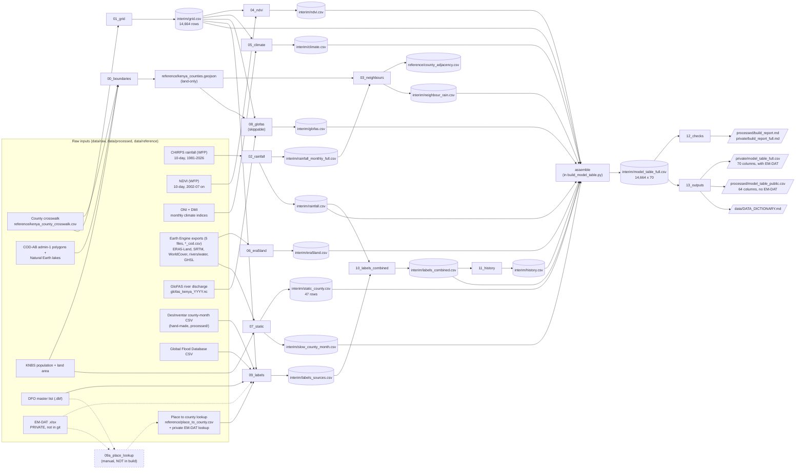

# The data pipeline, explained for beginners

*Kenya County Flood Risk Early Warning (Moringa DSF-PT15, Group 6).*

This guide explains how the code in `src/data/` turns a pile of downloaded files into one clean table, one row per county per month. It describes what the code **actually does today**, not what was planned. Where the code and the planning notes (`data/DATA_NOTES.md`) differ, the code wins and this guide says so.

It was written on 29 Oct 2026 by reading every file in `src/data/`, `data/DATA_DICTIONARY.md`, `data/processed/build_report.md` and the logs, and by running read-only look-ups against the data files to get real numbers. **No pipeline code was changed or run to write the first version.** A later pass (after the review in this guide) fixed eight things it found; those changes are folded into the sections below. On 1 Nov 2026 the rainfall/NDVI rule changed (the WFP `adm_level` 1 rows turned out to be former provinces, see 3.3); the sections and numbers affected have been updated.

> **How to use this guide.** If you have never built a pipeline, read sections 1 and 2 first (about 15 minutes), then section 4 (one real row, start to finish). Sections 3, 5 and 7 are reference material to come back to when you touch the code. Section 10 has self-check questions.

---

## Read this first: three things about the current state of the repo

These are facts about the files on disk when this guide was written. They are the kind of thing a pipeline is supposed to make visible, so they are worth knowing before you trust any number.

1. **GloFAS (river discharge) is complete and in the table.** All 27 yearly files (1999-2025) are on disk and validated, and `discharge_rank` / `discharge_rank_lag1` are filled for every county-month (20 of the 20 baseline years 2000-2019 are present). Stage 8 still leaves a rank blank for any county + calendar month with fewer than 15 baseline years, but that no longer happens. **One known source gap:** ECMWF has no data for the 2024-12-31 request (valid_time 2025-01-01; the server's own list of available days for December 2024 stops at the 30th), so **December 2024 is a mean over 30 of 31 days**. The check allows exactly that one date and stops with an error for any other missing day. The build report's GloFAS line states the gap (section 3, stage 8).
2. **`glofas_kenya_2020.nc` was a broken download (fixed).** It was a 55 KB one-day *test* job that the downloader had reused because it only compared the year. The file is deleted and the downloader now re-uses a server job only if its request matches the full-year request exactly (all 12 months, 31 day slots, same variable, product, version and area). It also refuses to keep a download unless every day of the year is present (checked by date, not by count), apart from the single known source gap above. The real full-year 2020 file (366 days) is now on disk.
3. **The public table under-counts floods after 2018, including Kisumu's April-May 2024 floods.** The Global Flood Database's last flagged year is 2018, DFO's is 2010, and DesInventar has no records in 2017-2019, so after 2018 the public labels come from DesInventar alone. Result: 732 flagged county-months (6.5%) in 2000-2019 against only 17 (0.5%) in 2020-2025. Only EM-DAT, which lives in the private table, covers those months. This is a data-coverage limit, not a bug, but it makes test-period metrics on the public labels untrustworthy. The build report (section 3 and the known caveats) and the data dictionary now say so. Section 4 walks through the Kisumu example.

---

## Contents

1. [What a data pipeline is](#1-what-a-data-pipeline-is)
2. [The big picture](#2-the-big-picture)
3. [Stage-by-stage walkthrough](#3-stage-by-stage-walkthrough)
4. [Follow one row through the whole pipeline (Kisumu, April 2024)](#4-follow-one-row-through-the-whole-pipeline)
5. [The shared helpers (`common.py`)](#5-the-shared-helpers-commonpy)
6. [How to run and re-run it](#6-how-to-run-and-re-run-it)
7. [How to change it safely](#7-how-to-change-it-safely)
8. [How this becomes the live prediction pipeline](#8-how-this-becomes-the-live-prediction-pipeline)
9. [Glossary](#9-glossary)
10. [Self-check questions](#10-self-check-questions)

---

## 1. What a data pipeline is

### 1.1 The plain-English definition

A **data pipeline** is a series of scripts that run in a fixed order. Each one reads some files, does one job, and writes new files. The next script reads what the previous one wrote. At the end, you get a finished dataset.

Think of a kitchen line: one person washes, one chops, one cooks, one plates. Nobody does everything, and the order matters. In this repo the "washing" is things like fixing county codes, the "chopping" is turning 10-day rainfall into monthly rainfall, and the "plating" is writing the final model table.

### 1.2 Why we built one instead of cleaning data by hand in notebooks

You *could* open a notebook, click through the cleaning, save a CSV and carry on. Here is why that goes wrong for this project:

- **Reproducibility.** A notebook run by hand depends on the order you clicked cells and on what was in memory. The pipeline is a single command (`python src/data/build_model_table.py`) that starts from the raw files every time, so anyone gets the same table.
- **Re-running when new data arrives.** GloFAS river data was still downloading while we built everything else. With a pipeline, when the files arrive you re-run one command and the new columns fill in. By hand, you would redo every step and hope you remembered them all.
- **Teammates get the same result.** Four people work on this. If each cleans differently (one fills missing NDVI with zeros, another leaves it blank), the models disagree and nobody knows why. The pipeline is the single written-down answer to "how did we clean it?"
- **Checking is built in.** The pipeline asserts things like "exactly 14,664 rows" and "no duplicate keys" every time it runs. A notebook only checks what you remembered to look at.
- **The monthly prediction pipeline later.** The final product predicts next month's flood risk. That means running the same cleaning on fresh data every month. Code that already exists as stages can be reused; a notebook cannot (section 8).

### 1.3 Key ideas, each with an example from this repo

**Stages.** A stage is one script that does one job. This repo has numbered stages: `01_grid.py` makes the empty table, `02_rainfall.py` adds rainfall, `09_labels.py` works out which months flooded. `build_model_table.py` is the conductor that runs them in order. The numbers in the file names *are* the run order.

**Inputs and outputs.** Every stage declares what it reads and what it writes. `02_rainfall.py` reads `data/raw/rainfall/ken-rainfall-subnat-full.csv` and writes `data/interim/rainfall.csv`. When something looks wrong in the final table, you follow the column back to the stage that wrote it. That is called tracing **lineage**, and it only works because inputs and outputs are explicit.

**Raw vs interim vs processed vs private (and reference).** The data folder is split by how trustworthy and how shareable a file is:

| Folder | What lives here | Example | In git? |
|---|---|---|---|
| `data/raw/` | Original downloads. Never edited by hand. | `raw/rainfall/ken-rainfall-subnat-full.csv` | yes (except EM-DAT and GloFAS `.nc`) |
| `data/interim/` | Work-in-progress files the pipeline writes between stages. Safe to delete; the build recreates them. | `interim/rainfall.csv` | **no** (git-ignored) |
| `data/reference/` | Small lookup tables and maps used by many stages. | `reference/kenya_county_crosswalk.csv` | yes |
| `data/processed/` | Finished, shareable outputs (and one hand-made input, see stage 9). | `processed/model_table_public.csv` | yes |
| `data/private/` | Outputs derived from EM-DAT, whose licence forbids sharing. | `private/model_table_full.csv` | **no** (git-ignored) |

One subtlety: stage 0 writes a *derived* shapefile into `data/raw/boundaries/cod_ab/` (`kenya_counties_cod_land.*`), because Earth Engine needs it uploaded. So "raw is never edited" really means "the original downloads are never edited". Stage 0 builds that shapefile in `data/interim/cod_land/` first and copies it into `raw/` only if its content differs from what is already there (the `.dbf` header's last-updated date is ignored in that comparison), so an ordinary rebuild leaves `data/raw/` untouched and git clean.

**Idempotency** (say it: *eye-dem-POH-ten-see*). Running the pipeline twice gives the same result as running it once, so it is safe to re-run whenever you like. Our build mostly has this: every stage overwrites its own output, the log is wiped at the start of a full build, and even the random spot-checks in `12_checks.py` use a fixed seed (`default_rng(20261029)`), so they pick the same rows each time. The exception is `09a_place_lookup.py`, which deliberately refuses to overwrite a file unless you pass `--force`, because that file holds hand-confirmed decisions.

**Skippable stages (GloFAS).** Some stages depend on data that may not exist yet. `08_glofas.py` handles that two ways. If it finds no `glofas_kenya_<year>.nc` files, it still runs and writes the two discharge columns as empty (`NaN`), logging `GloFAS pending`. Separately, you can pass `--skip 08_glofas` to leave the stage out: if an earlier `data/interim/glofas.csv` exists it is reused; if not (a fresh clone), the conductor writes the all-`NaN` placeholder itself without reading any `.nc` file, so `--skip 08_glofas` works the first time. The table keeps its shape either way, which is the point: the rest of the build never has to care whether GloFAS is ready.

**Fallbacks (the `_cod` files).** Earth Engine exports come in two versions: the old `<name>.csv` (made with the DesInventar county polygons, keyed by an old county code) and the newer `<name>_cod.csv` (made with the official OCHA COD-AB land-only polygons, keyed by `pcode`). The helper `read_ee_county_csv` in `common.py` uses the `_cod` file if it exists and falls back to the old one if not, and logs which it used. Today all five are `_cod`.

**Logging.** `common.log(stage, msg)` prints a timestamped line *and* appends it to `data/interim/build_log.txt`. Example from the log: `19:25:41 [08_glofas] WARNING: coverage 1999-2000 does not span 1999-2025; unfilled months stay NaN`. The log is your record of what happened in the last build. Logging is not the same as checking: a warning in the log does not stop the build.

**Validation checks.** Code that stops the build when something is wrong. These are `assert` lines (stop with an error if the statement is false) scattered through every stage, plus the checks in `12_checks.py`. Example from stage 1: `assert len(grid) == 14664 and not grid.duplicated(["pcode", "year", "month"]).any()`. The rule of thumb: **a pipeline that fails loudly is better than one that quietly produces a wrong table.**

**Leakage.** Leakage is when a feature secretly contains information from the future, so a model looks brilliant in testing and fails in real life. We predict *next month's* flood, so any feature that peeks at next month or later is leakage. The ONI climate index is the textbook case here: NOAA's published value for month *t* averages months *t-1*, *t* and *t+1*, so using it raw would leak a month ahead. Stage 5 shifts it by one month to fix that.

**Training-only baselines.** To say "April rainfall was 124% of normal" you need a definition of normal. If "normal" were computed using the years you later test on, the test data would have leaked into the features. So every "normal", percentile and flood rate in this repo uses **training years 2000-2019 only** (`BASE_START, BASE_END = 2000, 2019` in `common.py`). The test years are 2020-2025.

**Public vs private outputs.** EM-DAT's licence forbids redistributing it or databases derived from it. So the pipeline builds *two* label versions in parallel: a "full" version with EM-DAT (kept in git-ignored `data/private/`) and a "public" version without it (in `data/processed/`). Columns ending `_public` are the EM-DAT-free versions, and stage 13 renames them to the standard names in the public table. Both tables have the same rows; they differ in labels.

---

## 2. The big picture

### 2.1 The flow, drawn

Read it left to right: raw sources on the left, stages in the middle, files they write after them, and the final tables on the right. Stage 9a is dashed because it is *not* part of the build (see its section).



If the diagram does not render in your viewer, the table in 2.2 carries the same information.

### 2.2 The stages in one table

"Time" comes from the timestamps in the last full build log (19:25, 29 Oct 2026). The whole build took about **20 seconds** from `01_grid` to `13_outputs`. Stage 8 will be slower once all 27 GloFAS year-files are present (each is about 8 MB); that has not been timed yet.

| # | Script | Reads | Writes | Time |
|---|---|---|---|---|
| 0 | `00_boundaries.py` | COD-AB admin-1 shapefile, Natural Earth lakes, crosswalk, KNBS areas | `raw/boundaries/cod_ab/kenya_counties_cod_land.*`, `reference/kenya_counties.geojson`, `reference/kenya_counties_full.geojson`, `interim/boundary_area_check.csv` | a few seconds (not timed: the log only shows when it finished) |
| 1 | `01_grid.py` | crosswalk | `interim/grid.csv` | under 1 s |
| 2 | `02_rainfall.py` | `raw/rainfall/ken-rainfall-subnat-full.csv` | `interim/rainfall_monthly_full.csv`, `interim/rainfall.csv` | about 4 s |
| 3 | `03_neighbours.py` | `kenya_counties.geojson`, `rainfall_monthly_full.csv` | `reference/county_adjacency.csv`, `interim/neighbour_rain.csv` | about 1 s |
| 4 | `04_ndvi.py` | `raw/ndvi/ken-ndvi-subnat-full.csv`, `grid.csv` | `interim/ndvi.csv` | about 1 s |
| 5 | `05_climate.py` | `raw/climate_indices/oni.csv`, `dmi_ersstv6.txt`, `grid.csv` | `interim/climate.csv` | under 1 s |
| 6 | `06_era5land.py` | `raw/earth_engine/era5land_soil_runoff_county_month_cod.csv` | `interim/era5land.csv` | under 1 s |
| 7 | `07_static.py` | four more Earth Engine `_cod` files, population CSV, `grid.csv` | `interim/static_county.csv` (47 rows), `interim/slow_county_month.csv` | about 1 s |
| 8 | `08_glofas.py` | `raw/glofas/glofas_kenya_<year>.nc`, `kenya_counties.geojson`, `grid.csv` | `interim/glofas_county_month_max.csv`, `interim/glofas.csv` | about 2 s with 2 files; longer with 27 (untimed) |
| 9a | `09a_place_lookup.py` | DFO `.dbf`, EM-DAT `.xlsx` | `reference/place_to_county.csv`, `private/place_to_county_emdat.csv`, review CSVs | **not in the build**; run by hand |
| 9 | `09_labels.py` | `processed/desinventar_floods_county_month.csv`, GFD CSV, DFO `.dbf`, EM-DAT `.xlsx` (optional), both place lookups, `grid.csv` | `interim/labels_sources.csv`, `private/emdat_event_notes.csv` | about 5 s |
| 10 | `10_labels_combined.py` | `labels_sources.csv`, `rainfall.csv` | `interim/labels_combined.csv` | under 1 s |
| 11 | `11_history.py` | `labels_combined.csv` | `interim/history.csv` | under 1 s |
| - | *assemble* (in `build_model_table.py`) | the nine feature files + `static_county.csv` | `interim/model_table_full.csv` (14,664 x 70) | about 1 s |
| 12 | `12_checks.py` | `model_table_full.csv`, raw rainfall and ONI, build log | `processed/build_report.md`, `private/build_report_full.md` | about 2 s |
| 13 | `13_outputs.py` | `model_table_full.csv` | `private/model_table_full.csv`, `processed/model_table_public.csv` (14,664 x 64), `DATA_DICTIONARY.md` | about 1-2 s |

Support files that are not stages: `common.py` (shared helpers, section 5), `placenames.py` (the place-name dictionary and text parser), `place_sources.py` (loaders for DFO, EM-DAT and the lookups).

### 2.3 Three words you will see constantly

- **County-month.** One row of our table: one county in one calendar month. 47 counties x 312 months (Jan 2000 to Dec 2025) = **14,664 rows**. Everything in the pipeline is about producing exactly one trustworthy row per county-month.
- **`pcode`.** The official county code, `KE001` to `KE047` (Kisumu is `KE042`). It is the join key: the column used to line tables up. Other sources use other codes, and the crosswalk file translates between them.
- **Key.** The set of columns that uniquely identifies a row: `pcode` + `year` + `month`. Stages write files keyed this way so that the final assembly is just "join on the key".

---

## 3. Stage-by-stage walkthrough

Every stage section has the same layout: **the problem it solves**, **inputs**, **key steps in plain English**, **key lines of code** explained one by one, **outputs**, **checks it runs**, and **decisions behind it**. Code is quoted exactly as it is in the repo.

First, how the conductor works, because it explains why the stage file names start with digits.

### 3.0 The conductor: `build_model_table.py`

**The problem.** Fourteen scripts have to run in the right order, and a failure in one must stop everything.

```python
PRE = ["00_boundaries", "01_grid", "02_rainfall", "03_neighbours", "04_ndvi", "05_climate", "06_era5land", "07_static",
       "08_glofas", "09_labels", "10_labels_combined", "11_history"]
POST = ["12_checks", "13_outputs"]
```
- `PRE` is the list of stages that run *before* assembly, in order. `POST` runs after. Adding a stage to the build means adding its name here.

```python
def run_stage(name):
    spec = importlib.util.spec_from_file_location(name, HERE / f"{name}.py")
    mod = importlib.util.module_from_spec(spec)
    spec.loader.exec_module(mod)
    mod.run()
```
- Python cannot do `import 02_rainfall` because a module name cannot start with a digit. So the conductor loads each file *by path* with `importlib`, then calls its `run()` function. That is why every stage file defines `run()`.

```python
    LOG_FILE.write_text("", encoding="utf-8")
    for s in PRE:
        if s in a.skip:
            log("build", f"skipping {s}")
            continue
        run_stage(s)
    assemble()
    for s in POST:
        run_stage(s)
```
- `LOG_FILE.write_text("")` empties the log, so the log always describes the latest full build.
- The loop runs each pre-stage unless named in `--skip`. If any stage raises an error, the loop stops right there and nothing later runs. That "stop at the first failure" behaviour is deliberate.

**Stage 9a is not in either list.** It is run by hand only (see its section).

---

### 3.1 Stage 0: `00_boundaries.py` (county shapes, minus the lakes)

**The problem.** We need a polygon (the outline) for each of the 47 counties for three jobs: finding which counties touch (stage 3), finding which river-grid cells lie inside a county (stage 8), and defining the area Google Earth Engine averages over. The polygons that came with DesInventar are wrong for four counties (Bomet, Murang'a, Kericho, Kiambu), so the official OCHA **COD-AB** layer is used instead. But the official county outlines include the Kenyan parts of Lake Victoria and Lake Turkana, which would make "elevation" and "land cover" for Homa Bay or Turkana partly about water. So the big lakes are cut out.

**Inputs.** `data/raw/boundaries/cod_ab/ken_admin1.shp` (official counties), `data/raw/boundaries/natural_earth_lakes/ne_10m_lakes.shp` (world lake outlines), the crosswalk, and the KNBS land areas (for a sanity check).

**Key steps.**
1. Load the 47 county polygons and check each is a valid shape.
2. Load three lakes by name: Lake Victoria, Lake Turkana, Lake Natron.
3. For every county, subtract each lake, recording how many km² were removed.
4. Write three files: a land-only shapefile (to upload to Earth Engine), a land-only GeoJSON (for the pipeline), and an unclipped GeoJSON (for the dashboard map only).
5. Read the shapefile back and confirm nothing was lost in the round trip.
6. Compare each county's land-only area with the official KNBS land area.

**Key lines.**

```python
LAKES_REMOVED = ["Lake Victoria", "Lake Turkana", "Lake Natron"]
```
- The cut list is explicit. Small lakes and dams (for example Masinga Reservoir) deliberately stay in, so `pct_water` keeps its meaning.

```python
_to_ea = Transformer.from_crs(4326, 6933, always_xy=True).transform  # equal-area, for km2
```
- Latitude/longitude (EPSG:4326) are angles, not kilometres, so an area computed on them is meaningless. Code 6933 is an **equal-area projection**, which lets us compute real km². `always_xy=True` fixes the argument order as (longitude, latitude).

```python
for lname, lake in lakes.items():
    inter = g.intersection(lake)
    a = area_km2(inter)
    if a > 0:
        lost.append((lname, cw[pcode], a))
    h = h.difference(lake)
```
- For each lake: `intersection` is the overlap (how much lake sits in this county), which we record for the log; `difference` removes it. The shapes are carried forward in `h` so a county touching two lakes loses both.

```python
h = shapely.make_valid(h)
if h.geom_type == "GeometryCollection":  # drop stray lines/points left by the difference
    h = shapely.union_all([p for p in h.geoms if p.geom_type in ("Polygon", "MultiPolygon")])
assert not h.is_empty and h.is_valid, f"{pcode}: land-only geometry is empty/invalid"
```
- Cutting shapes can leave junk (a hairline, a stray point). `make_valid` repairs the geometry and the `GeometryCollection` branch keeps only real areas. The `assert` refuses to continue with an empty or broken county.

```python
assert len(sf) == 47 and [f[0] for f in sf.fields[1:]] == ["pcode", "county"]
for sr in sf.shapeRecords():
    back = shape(sr.shape.__geo_interface__)
    assert back.is_valid and abs(area_km2(back) / area_km2(land[sr.record["pcode"]]) - 1) < 1e-6
```
- "Read it back and compare." Writing a file and trusting it is how silent corruption happens. This re-opens the shapefile and checks 47 features, the two field names, and that every area matches to one part in a million.

**Outputs.**
- `data/raw/boundaries/cod_ab/kenya_counties_cod_land.{shp,shx,dbf,prj,cpg}`: fields `pcode`, `county`. **This is the file you upload to Earth Engine as an asset** (an asset is a data file stored in your Earth Engine account that scripts can refer to by name).
- `data/reference/kenya_counties.geojson`: land-only; used by stages 3 and 8.
- `data/reference/kenya_counties_full.geojson`: unclipped; dashboard map only.
- `data/interim/boundary_area_check.csv`.

**Checks.** 47 counties; valid geometries; round-trip match; and a logged comparison with KNBS: median land/KNBS ratio is **1.000**, min 0.963, max 1.062 (sum 580,578 vs 580,876 km²).

**Decisions behind it.**
- *Official COD-AB over DesInventar polygons* because the DesInventar boundaries are wrong for four counties.
- *Land-only.* The log shows what was removed: Lake Turkana took 4,920 km² from Marsabit and 2,322 from Turkana; Lake Victoria took 1,514 from Homa Bay, 1,002 from Siaya, 584 from Kisumu, 520 from Migori and 133 from Busia.
- *Caveat:* the Natural Earth 10 m outline is coarser than the true shoreline, so a strip of open water remains in Homa Bay, Siaya, Migori and Marsabit, and `lc_water`/`pct_water` are a few points high there (the build report quantifies it).

---

### 3.2 Stage 1: `01_grid.py` (the empty table)

**The problem.** Every other stage produces data for *some* county-months. If we merged them directly, a missing month in one source would silently shrink the table. Instead we first build the **complete empty frame**, one row per county-month, and every later stage is merged *onto* it. A source with gaps then leaves a visible blank rather than a missing row.

**Inputs.** The crosswalk only.

**Key steps.** Cross every county with every year-month from 2000-01 to 2025-12; add the season; add two cyclic month features; assert 14,664 unique rows; save.

**Key lines.**

```python
months = pd.MultiIndex.from_product([range(FIRST_YEAR, LAST_YEAR + 1), range(1, 13)], names=["year", "month"])
```
- Builds every (year, month) pair: 26 years x 12 months = 312.

```python
grid = cw[["pcode", "county"]].merge(ym, how="cross").sort_values(["pcode", "year", "month"], ignore_index=True)
```
- A **cross join** pairs each of 47 counties with each of 312 months: 47 x 312 = 14,664. Sorting by `pcode, year, month` matters: later stages that compute lags assume this order.

```python
grid["season"] = grid["month"].map(SEASON)
grid["month_sin"] = np.sin(2 * np.pi * grid["month"] / 12)
grid["month_cos"] = np.cos(2 * np.pi * grid["month"] / 12)
```
- `SEASON` maps months to Kenya's rain seasons: JF (Jan-Feb), MAM (Mar-May, the "long rains"), JJAS (Jun-Sep), OND (Oct-Dec, the "short rains").
- Why sine and cosine? A model given `month = 12` and `month = 1` sees numbers 11 apart, though December and January are neighbours. Putting months on a circle with sin/cos makes them neighbours again. For April the values are `sin = 0.866`, `cos = -0.5` (you will see exactly these in section 4).

```python
assert len(grid) == 14664 and not grid.duplicated(["pcode", "year", "month"]).any()
```
- The master check. If this ever fails, nothing downstream can be trusted.

**Outputs.** `data/interim/grid.csv` (14,664 rows: `pcode, county, year, month, season, month_sin, month_cos`).

**Decisions.** Build the *full* grid even for months where some inputs are blank (NDVI before 2002-07). Whether to drop those rows is a modelling decision left for later (`DATA_NOTES.md`), not a cleaning decision.

---

### 3.3 Stage 2: `02_rainfall.py` (CHIRPS rainfall to monthly features)

**The problem.** Rainfall arrives as 10-day totals ("dekads"), split by sub-county, plus some extra rows for whole provinces that carry a county code. We need one clean number per county per month, plus "how wet was this month compared with usual" and the last two months for context.

**Inputs.** `data/raw/rainfall/ken-rainfall-subnat-full.csv` (133,488 rows, 1981-01 to 2026-10). Key columns: `date`, `adm_level`, `PCODE`, `n_pixels`, `rfh` (rainfall in mm over the dekad).

**Key steps.**
1. Turn dekads into one value per county per dekad (the sub-county rule, in `common.wfp_county_dekads`).
2. Sum three dekads into a month; also record the wettest dekad.
3. Compute lags and the 3-month total on the **full 1981-2025 series**, then trim to 2000-2025.
4. Compute `rain_pct_normal` against the 2000-2019 monthly average.

**Key lines.**

```python
dek = wfp_county_dekads(SRC, ["rfh", "rfh_avg"], STAGE)
report_rfh_avg_period(dek)
dek = dek[["pcode", "date", "rfh"]]
mon = dekads_to_months(dek, "rfh", ["sum", "max"], STAGE).rename(columns={"sum": "rain_mm", "max": "rain_max_dekad"})
```
- Step 1 and 2. `wfp_county_dekads` builds county values for both `rfh` and WFP's own average `rfh_avg` in one pass; `rfh_avg` is used only by the side-investigation below and then dropped. `dekads_to_months` insists there are exactly 3 dekads per county-month (it asserts this), then aggregates twice: `sum` is the monthly rainfall in mm, `max` is the largest single dekad.

```python
mon = add_lags(mon, ["rain_mm"], [1, 2])
mon = mon.rename(columns={"rain_mm_lag1": "rain_lag1", "rain_mm_lag2": "rain_lag2"})
mon["rain_3mo_total"] = mon["rain_mm"] + mon["rain_lag1"] + mon["rain_lag2"]
```
- A **lag** is the value from earlier months, in the same county. `rain_lag1` is last month's `rain_mm`, `rain_lag2` is two months ago. The 3-month total adds this month and the two before it, so it only looks backward. Because this runs on the data back to 1981, January 2000 already has real December and November 1999 values instead of blanks.

```python
normal = baseline_mean(mon, "rain_mm")
mon["rain_pct_normal"] = mon["rain_mm"] / normal.where(normal > 0)
```
- `baseline_mean` returns, for each row, the average `rain_mm` of the **same county and same calendar month over 2000-2019**. Dividing gives a ratio: 1.0 is a normal month, 1.25 is 125% of normal. Despite the `pct` in the name, it is a ratio, not a percentage. `normal.where(normal > 0)` turns a zero normal into blank rather than dividing by zero (and logs a warning if it happens).

```python
out = mon[mon["year"] >= FIRST_YEAR]
assert len(out) == 14664 and out[cols].notna().all().all()
```
- Only now do we cut to 2000 onwards, and assert the right size with **no blanks at all** in these columns.

**Outputs.** `data/interim/rainfall_monthly_full.csv` (just `rain_mm`, 1981-2025; needed by stage 3) and `data/interim/rainfall.csv` (9 columns, 2000-2025).

**Checks.** 3 dekads per county-month; 47 counties; no duplicate dekads; no blank rainfall; 14,664 rows; and a logged range for `rain_pct_normal` (0.117 to 6.179, with 26.1% of county-months above 1.25). Stage 12 later recomputes four county-months from the raw file by hand (section 3.15).

**A side-investigation the stage runs every time.** `report_rfh_avg_period(dek)` works out which years WFP's own average column `rfh_avg` covers, by testing every window of years on the county values of three counties (Nairobi, Tana River, Nyeri). The answer logged is **1989-2018**. The pipeline does *not* use `rfh_avg`, because its window (1989-2018) is not our training window (2000-2019), so using it would mix two different definitions of "normal". The window is logged so nobody uses it by mistake.

**Decisions behind it: the sub-county rainfall rule (changed 1 Nov 2026).** The WFP file has two kinds of rows, marked by `adm_level`. **Level 2** rows describe sub-counties, and every one of the 47 counties has them. **Level 1** rows exist for only eight codes (KE004, KE008, KE010, KE019, KE023, KE037, KE043, KE047), and they are **not counties**: they are Kenya's former **provinces**, labelled with one county's code. You can see it from the pixel counts (one pixel is about 30.8 km²): the `KE023` row has 5,604 pixels, about 172,600 km², which is the old Rift Valley province, not Turkana (68,111 km²). The `KE019` row is about 13,150 km², Central province, not Nyeri (3,350 km²). Only Nairobi's row matches its county, because Nairobi was its own province.

The rule, in `common.py`:
- **drop every `adm_level` 1 row**;
- build **all 47 counties from their level-2 rows**, matched to a county by the **first five characters of the level-2 code** (`KE042241` belongs to `KE042`) and combined as a mean **weighted by `n_pixels`** (how many satellite pixels each sub-county covers, so a big area counts more than a tiny one).

The old rule used the level-1 row for those eight counties, so they got the rain of a whole province. Turkana came out at **716 mm a year instead of about 305**, the 12th driest county instead of the driest. Rain-based features for neighbouring counties were affected too. The log confirms the new split: 12,960 province rows dropped; 47 counties from 73 sub-county areas, 26 counties with a single area and 21 needing weighting.

**Known limitation: some sub-counties seem to be filed under the wrong county.** Summing each county's level-2 pixels (x 30.8 km²) and comparing with its land area from WorldCover gives a ratio of 0.93 to 1.07 for 39 counties. Two pairs stand out, and in each pair one county is short by about what its neighbour has extra, so some sub-counties appear to be filed under the neighbouring county: **Kiambu 0.51 and Murang'a 1.44**, and **Kericho 0.82 and Bomet 1.19**. Their rainfall is therefore partly the neighbour's. **Mombasa 1.31, Nairobi 1.13 and Turkana 0.85** are treated as edge effects: in the two small counties whole pixels overhang the border or the sea, and Turkana's shortfall is not traced to a neighbour (no neighbour shows a matching excess). This is not fixed; recomputing rainfall for the county polygons in Earth Engine is a separate decision.

**Decision: the dekads-sum-to-month choice.** `rfh` is rainfall in mm over a dekad, so a month's rain is the sum of its three dekads (`DATA_NOTES.md` notes it equals the last dekad's `r1h` column, a useful cross-check).

---

### 3.4 Stage 3: `03_neighbours.py` (what rained next door)

**The problem.** Floods in a county are often caused by rain that fell upstream, in a neighbouring county. We want a feature that says "how much did my neighbours get?" First we need to know who the neighbours are, and the data does not contain that; it has to be computed from the county shapes.

**Inputs.** `data/reference/kenya_counties.geojson` (from stage 0) and `data/interim/rainfall_monthly_full.csv` (from stage 2).

**Key steps.** Decide adjacency (two counties are neighbours if their outlines touch); save the adjacency list; for each county and month, average the neighbours' rainfall; add a one-month lag; trim to 2000-2025.

**Key lines.**

```python
buffered = [geoms[p].buffer(BUFFER_DEG) for p in pcodes]
tree = STRtree(buffered)
```
- Each polygon is fattened by `BUFFER_DEG = 0.001` degrees (about 110 m). Hand-drawn borders have tiny slivers of gap between them; the buffer closes those so that touching counties register as touching. `STRtree` is a spatial index that finds candidate overlaps quickly instead of comparing all 47x47 pairs.

```python
for j in tree.query(buffered[i], predicate="intersects"):
    if j == i:
        continue
```
- For each county, find every buffered polygon that intersects it, skipping itself.

```python
assert all((b, a) in pairs for a, b in pairs), "adjacency is not symmetric"
```
- If A is a neighbour of B, B must be a neighbour of A. This one line would catch a broken polygon.

```python
A = pd.crosstab(adj.pcode, adj.neighbour_pcode).reindex(index=wide.columns, columns=wide.columns, fill_value=0)
A = A.div(A.sum(axis=1), axis=0)
nr = pd.DataFrame(wide.to_numpy() @ A.to_numpy().T, index=wide.index, columns=wide.columns)
```
- `wide` is the rainfall reshaped so each row is a month and each column a county. `A` is a 47x47 table of 1s where counties are neighbours, then each row is divided by its sum, so a county with five neighbours gets 0.2 on each. The `@` is matrix multiplication; it computes every county's neighbour-average for every month in one step. Note that the weights are equal: a neighbour sharing 2 km of border counts the same as one sharing 90 km (the shared-border length is saved in the CSV but is not used in the average).

```python
long = add_lags(long, ["neighbour_rain"], [1])
out = long[long["year"] >= FIRST_YEAR][["pcode", "year", "month", "neighbour_rain", "neighbour_rain_lag1"]]
assert len(out) == 14664 and out.notna().all().all()
```
- Same pattern as stage 2: lag on the full series, then trim, then assert.

**Outputs.** `data/reference/county_adjacency.csv` (244 directed pairs = 122 borders) and `data/interim/neighbour_rain.csv`.

**Checks.** No county has zero neighbours (it raises an error); symmetry; no blanks. The stage also *notes* 11 borders shorter than 2 km (for example Tana River-Meru 0.2 km) that might be corner-touches; they are still counted as neighbours and flagged in the log so the team can disagree.

**Decisions.** "Neighbour" means *polygons touch*, not "rain falls on the upstream side"; this is a simple stand-in for upstream rainfall. It uses the **land-only** polygons from stage 0, so a lake does not create fake adjacency across the water.

---

### 3.5 Stage 4: `04_ndvi.py` (how green is it)

**The problem.** NDVI (Normalised Difference Vegetation Index, a satellite measure of how green the land is) arrives in the same awkward dekad/level format as rainfall. Wet soil and lush vegetation are a hint about how much more rain the ground can absorb. NDVI only starts in July 2002, and we must not invent data for the earlier months.

**Inputs.** `data/raw/ndvi/ken-ndvi-subnat-full.csv` (column `vim`) and `grid.csv`.

**Key steps.** Reuse the same county/dekad rule (`wfp_county_dekads(SRC, ["vim", "vim_avg"], STAGE)`, level-2 rows only; `vim_avg` is aggregated but not used); average (not sum) the three dekads; compute a ratio to the same-month average; merge onto the grid, leaving the early months blank.

**Key lines.**

```python
mon = dekads_to_months(dek, "vim", "mean", STAGE).rename(columns={"vim": "ndvi"})
```
- Rainfall is *summed* over dekads (it accumulates); NDVI is a level, so we take the **mean** of the three.

```python
normal = mon[mon["year"] <= BASE_END].groupby(["pcode", "month"])["ndvi"].mean().rename("_normal")
mon["ndvi_pct_normal"] = mon["ndvi"] / mon["_normal"].where(mon["_normal"] > 0)
```
- The training-years-only baseline again (`year <= 2019`). Because the data starts in 2002, the "normal" is built from the available 2002-07 to 2019-12 months, so, for example, the normal for April uses 17 Aprils, not 20.

```python
out = grid.merge(mon[["pcode", "year", "month", "ndvi", "ndvi_pct_normal"]], how="left", on=["pcode", "year", "month"])
ym = out["year"] * 100 + out["month"]
assert out.loc[ym < 200207, ["ndvi", "ndvi_pct_normal"]].isna().all().all()
assert out.loc[ym >= 200207, ["ndvi", "ndvi_pct_normal"]].notna().all().all()
```
- `how="left"` on the grid keeps all 14,664 rows. The two asserts state the exact expectation: *blank before 2002-07, never blank from 2002-07 on*. `ym` turns (2002, 7) into 200207 so the comparison is one number.

**Outputs.** `data/interim/ndvi.csv` (14,664 rows; 1,410 blank = 47 counties x 30 months).

**Checks.** Exactly 3 dekads per month; 47 counties; the two asserts above.

**Decisions.** Leave the 30 early months blank rather than fill with zeros or the mean: a model can be told "missing", but a made-up number is a lie. The build report lists these 1,410 nulls as "as expected".

---

### 3.6 Stage 5: `05_climate.py` (El Niño and the Indian Ocean Dipole)

**The problem.** Two ocean-temperature indices influence East African rainfall: **ONI** (Oceanic Niño Index, El Niño/La Niña) and **DMI** (Dipole Mode Index, the Indian Ocean Dipole). They are the same value for every county in a given month. The traps are a missing-value code and, more importantly, a **leakage** trap in ONI.

**Inputs.** `raw/climate_indices/oni.csv`, `raw/climate_indices/dmi_ersstv6.txt`, `grid.csv`.

**Key steps.** Replace `-9999` with blank; shift ONI by one month; read the DMI text file; add lags 1-3 to both; trim; merge on `year, month` only (not county).

**Key lines.**

```python
oni["oni"] = oni["oni"].replace(-9999, float("nan"))
```
- `-9999` is the file's code for "no data". Left in, it would look like an absurdly cold ocean.

```python
oni["oni"] = oni["oni"].shift(1)  # month t now carries the published value for t-1 (rows are contiguous months)
chk = oni.set_index(["year", "month"])["oni"]
assert chk.loc[(2015, 12)] == published.loc[(2015, 11)] and chk.loc[(2016, 1)] == published.loc[(2015, 12)]
```
- **The ONI shift.** NOAA labels each 3-month running average by its *centre* month. So the published value for April averages March, April and May. When we sit at the end of April trying to predict May's flood, the published April number contains May: a peek into the future. After `shift(1)`, the row for month *t* holds the published value for month *t-1* (which averages *t-2, t-1, t*), all known by the end of month *t*. The `assert` proves the shift landed correctly at a year boundary, December 2015 -> January 2016. This was a **team decision**.

```python
dmi = pd.read_csv(RAW / "climate_indices" / "dmi_ersstv6.txt", sep=r"\s+", skiprows=13, header=None,
                  names=["year", "month", "wtio", "setio", "dmi"])
assert dmi.iloc[0][["year", "month", "dmi"]].tolist() == [1950, 1, 0.23], "DMI header skip is off"
```
- The DMI file is whitespace-separated text with a 13-line header, so we skip 13 lines and name the columns ourselves. The assert guards the fragile part: if NOAA changes the header length, the first data row would no longer be `1950, 1, 0.23` and the build stops instead of reading garbage.

```python
def with_lags(df, col):
    ...
    assert (t.diff().dropna() == 1).all(), f"{col}: months not contiguous"
    for k in (1, 2, 3):
        df[f"{col}_lag{k}"] = df[col].shift(k)
```
- `shift(k)` only equals "k months ago" if the rows are consecutive months with none missing, so the function asserts that first. Lags are computed on the full 1950+ series, so January 2000 has real values.

```python
out = grid.merge(clim, how="left", on=["year", "month"])
assert len(out) == 14664 and out[cols].notna().all().all()
```
- The merge key has no `pcode`, so each month's value is copied to all 47 counties.

**Outputs.** `data/interim/climate.csv` (8 climate columns).

**Checks.** Contiguous months; shift verified at a boundary; DMI header guard; 14,664 rows, no blanks. The log notes `ONI: 5 values of -9999 set to NaN (all after the 2026-07 last valid month)`, so none touch 2000-2025.

**Decisions.** The ONI shift (explained above). DMI is *not* shifted because it is a one-month value, not a centred running mean. Note the table also warns that DMI anomalies are measured against a 1991-2020 climatology, so those years overlap the test years slightly (a known caveat in the build report).

---

### 3.7 Stage 6: `06_era5land.py` (soil moisture and runoff rank)

**The problem.** Soil that is already saturated floods more easily. ERA5-Land (a European weather re-analysis) gives soil moisture and runoff, exported from Earth Engine per county per month. Two problems: the files come keyed by two different schemes (the `_cod` fallback), and ERA5 **runoff in absolute terms is unusable** (it overestimates rainfall in the highlands by up to 2.7x, and 22% of county-months have a "normal" under 1 mm so ratios reach 6,000%).

**Inputs.** `raw/earth_engine/era5land_soil_runoff_county_month_cod.csv` (via `read_ee_county_csv`). The sibling `era5land_precip_county_month.csv` is a diagnostic and is deliberately ignored.

**Key steps.** Read the export; rename the two soil layers; lag them by one month; convert runoff into a **rank** within each county-month; trim; assert.

**Key lines.**

```python
e = read_ee_county_csv("era5land_soil_runoff_county_month", STAGE,
                       usecols=["year", "month", "volumetric_soil_water_layer_1",
                                "volumetric_soil_water_layer_2", "runoff_sum"])
```
- One helper call replaces file-name logic and code-translation logic (section 5 explains it). It returns `pcode` plus the requested columns.

```python
e = add_lags(e, ["soil_moisture_l1", "soil_moisture_l2"], [1])
e["runoff_rank"] = baseline_percentile(e, "runoff_sum")
```
- Soil moisture gets a one-month lag. Runoff becomes `runoff_rank`: "where does this month's runoff fall among the same county's same-calendar-month runoffs in 2000-2019?" It is a number from 0 (lower than every training year) to 1 (higher than every training year). We use a **rank instead of raw runoff** because the absolute numbers are wrong, but the *order* of months within one county is still informative (month-to-month correlation with CHIRPS is 0.63-0.92).

```python
out = e[e["year"] >= FIRST_YEAR][["pcode", "year", "month"] + cols]
assert len(out) == 14664 and out[cols].notna().all().all()
```
- The export starts in 1999-10, so lag-1 for January 2000 is a real December 1999 value. Then trim and assert.

**Outputs.** `data/interim/era5land.csv` (5 feature columns).

**Checks.** No duplicate county-months in the export; the pcode set matches the crosswalk exactly (inside the helper); no blanks; the log reports `runoff_rank min 0.000 max 1.000`.

**Decisions.** Ranks instead of raw runoff (above); only soil layers 1 (0-7 cm) and 2 (7-28 cm) and a 1-month lag. Ranks are 0 or 1 whenever a month is outside the 2000-2019 range, which is expected.

---

### 3.8 Stage 7: `07_static.py` (terrain, land cover, rivers, people, buildings)

**The problem.** Some county properties do not change month to month (elevation, slope, how much is farmland, how many people live there). One more (built-up share) changes slowly. They come from four different Earth Engine exports and a census file, with different names and units.

**Inputs.** Four `_cod` exports (`srtm_elevation_slope_county`, `worldcover_landcover_county`, `proximity_rivers_water_county`, `ghsl_builtup_county_5yr`) and `raw/population/county_year_population.csv`.

**Key steps.** Read and tidy each static export; compute population density; merge into one 47-row table; separately, turn the 5-yearly built-up share into a monthly series.

**Key lines.**

```python
wc = wc.rename(columns={f"pct_{c}": f"lc_{c}" for c in LC_CLASSES})
share_sum = wc[[f"lc_{c}" for c in LC_CLASSES]].sum(axis=1)
log(STAGE, f"land-cover shares sum to {share_sum.min():.5f}-{share_sum.max():.5f} (fractions, not %)")
```
- The exports call land-cover columns `pct_tree` etc. but they are fractions (0-1), not percentages, so they are renamed `lc_tree`. Summing them should give 1.0; the log shows `0.99996-1.00000`. A quick way to catch a unit mistake.

```python
log(STAGE, "dropped river_dist_m and water_dist_m (capped at 5 km, nearly constant)")
```
- Two distance columns were dropped because they were capped at 5 km, so almost every county had the same value.

```python
cw["key"] = norm_name(cw["county"])
p["key"] = norm_name(p["county"])
if set(p["key"]) != set(cw["key"]) or cw["key"].nunique() != 47:
    raise RuntimeError(f"population county names do not map to the crosswalk: {miss_pop} / {miss_cw}")
```
- The population file spells Taita-Taveta as `Taita Taveta`. `norm_name` lowercases and strips everything except letters, so both become `taitataveta`. The code accepts a *spelling-only* difference but raises an error for anything else; it never guesses. The log records `MISMATCH resolved by punctuation only`.

```python
p = p[p["year"] == 2019].merge(cw[["key", "pcode"]], on="key", how="left")
p["pop_density"] = p["population"] / p["land_area_km2"]
```
- Only the 2019 census row is used, divided by KNBS **land** area (not the polygon area). This is a **static** value copied to every month, including 2000-2018, which is a known look-ahead (the dictionary says so).

```python
anchors = [0, 60, 120, 180, 240, 300]  # months since 2000-01-01 of the 1-Jan 2000, 2005, ..., 2025 anchors
...
rows.append((pc, y, m, float(np.interp(t, anchors, gg["pct_built"].to_numpy()))))  # holds 2025 flat
```
- GHSL gives the built-up share only every five years. `np.interp` draws a straight line between neighbouring anchors for each month, and holds 2025's value flat beyond the last anchor. Month number `t` counts months from January 2000.

```python
st = static_table().merge(population_density(), on="pcode", validate="one_to_one")
assert len(st) == 47 and not st.isna().any().any()
```
- `validate="one_to_one"` makes pandas raise if any county appears twice, which would otherwise silently duplicate rows.

**Outputs.** `data/interim/static_county.csv` (47 rows x 21 columns) and `data/interim/slow_county_month.csv` (14,664 rows: `pct_built`).

**Checks.** Pcodes match the crosswalk (inside the helper); shares sum to 1; population names map one-to-one; no blanks; and a **warning** (not a failure) if the five Earth Engine files mix `_cod` and old polygons.

**Decisions.** Static values are repeated on every row (the assembly step joins this file on `pcode` only). `pct_built` is mildly look-ahead for months before an anchor, because it interpolates toward the *next* anchor; the build report lists it as a caveat.

---

### 3.9 Stage 8: `08_glofas.py` (river discharge, the skippable stage)

**The problem.** GloFAS (the Global Flood Awareness System) estimates how much water flows down rivers, using daily grids of numbers. We need one number per county per month that reflects "how high are the rivers here relative to usual". The files are **NetCDF** (a format for gridded scientific data), one per year, and the stage must also cope with them not being there yet.

**Inputs.** `data/raw/glofas/glofas_kenya_<year>.nc` (variable `avg_dis`), `kenya_counties.geojson`, `grid.csv`.

**Key steps.**
1. Find the year-files. If none, write blank columns and stop (the "pending" path).
2. For each file, work out each time-step's *real* date, and accumulate a monthly mean per grid cell.
3. For each county, keep the **highest** monthly discharge among grid cells whose centre lies inside the county.
4. Convert that to a rank within county and calendar month (2000-2019), then lag it by one month.
5. Merge onto the grid.

**Key lines.**

```python
real = pd.DatetimeIndex(ds["valid_time"].values) - pd.Timedelta(days=1)
```
- **valid_time minus 1 day.** The variable is the *average river discharge over the last 24 hours*, and the file stamps each value with the time the 24 hours *ended*. A value stamped 1999-01-02 is the average for 1 January. I checked this against the real files: `glofas_kenya_1999.nc` has 365 time-steps from 1999-01-02 to 2000-01-01, which after subtracting a day is exactly 1 Jan to 31 Dec 1999. Without this line, every day would land in the wrong month at month boundaries.

```python
dup = seen & set(real.normalize())
if dup:
    raise RuntimeError(f"{f}: dates already read from another file: {sorted(dup)[:3]}")
```
- If two files contain the same day, the monthly mean would be wrong. The stage refuses to continue.

```python
sums[key] = sums.get(key, 0) + np.nansum(sub, axis=0)
counts[key] = counts.get(key, 0) + np.sum(~np.isnan(sub), axis=0)
```
- A running total and count per month and per grid cell. Summing across files means a month that straddles two files is still averaged correctly.

```python
inside = shapely.contains_xy(geom, lon2.ravel(), lat2.ravel()).reshape(lon2.shape)
...
mx = np.where(np.isnan(cells).all(axis=1), np.nan, np.nanmax(np.where(np.isnan(cells), -np.inf, cells), axis=1))
```
- `contains_xy` asks, for every grid-cell centre, "is this point inside the county?". Then we take the **maximum** across those cells, not the mean. Reason (from the docstring): the maximum picks up the main river; a mean would dilute it with dry hillsides. The `-np.inf` trick lets `nanmax` ignore blanks. A county with no cell centre inside (possible for a tiny one) is logged and left blank.

```python
full = pd.period_range(f"{keys[0] // 100}-{keys[0] % 100:02d}", f"{keys[-1] // 100}-{keys[-1] % 100:02d}", freq="M")
...
d["discharge_rank"] = baseline_percentile(d, "discharge_max_cell", min_years=MIN_BASELINE_YEARS)   # MIN_BASELINE_YEARS = 15
d = add_lags(d, ["discharge_rank"], [1])
```
- The series is rebuilt with *every* month in the range, so the lag is exactly one calendar month even when a year-file is missing. Then the same `baseline_percentile` helper used for runoff turns it into a rank, **but only for a county + calendar month that has at least 15 of the 20 baseline years (2000-2019)**; otherwise the rank is left blank (`min_years=15`). Other users of the helper (runoff) keep the default `min_years=1`.

```python
files = [] if pending_only else sorted(...)      # pending_only=True never reads a .nc
if not files:
    log(STAGE, "GloFAS pending: ...; discharge columns left as NaN")
    out = grid.assign(discharge_rank=np.nan, discharge_rank_lag1=np.nan)
    out.to_csv(out_path, index=False)
    return
```
- The **skippable** path: no files (or `run(pending_only=True)`, which `build_model_table.py --skip 08_glofas` uses when no `interim/glofas.csv` exists yet, i.e. on a fresh clone) means an all-blank output file in the right shape, so assembly can proceed.

**Outputs.** `data/interim/glofas_county_month_max.csv` (county-month maximum, for inspection) and `data/interim/glofas.csv` (`discharge_rank`, `discharge_rank_lag1` on the grid).

**Checks.** Variable and `valid_time` must exist; dimensions must be `valid_time, latitude, longitude`; every file must share the first file's grid; no duplicate days; warns on missing years inside the range; warns when coverage does not span 1999-2025; raises an error for any missing day other than the one known source gap (2024-12-31), which it logs and records; warns about months with fewer days than the calendar; and logs how many baseline years each county + calendar month has (for example `baseline years present per county+month: min 3, max 3; 0/564 county+calendar-months have >= 15 of 20, the rest stay NaN`). The downloader also refuses files with missing days (section 6.2).

**Decisions.** Maximum cell not mean; ranks not raw (discharge differs wildly between rivers); 2000-2019 baseline; the 1999 file exists so January 2000's lag and December 1999 are real.

> **The old trap, now closed.** Before the 15-year rule, `baseline_percentile` ranked each month against whatever 2000-2019 values *existed*. With only the 2000 file loaded every baseline had exactly one value, so all 564 filled ranks were `(0+1)/2/1 = 0.5`, meaningless numbers that looked like data. Now a county + calendar month with fewer than 15 of the 20 baseline years gets a blank rank. All 20 baseline years are on disk, so every rank is filled (14,664 of 14,664). The build report's GloFAS line reports the real coverage (`PENDING`, `NOT USABLE YET`, `PARTIAL` or `COMPLETE`) and the known source gap, which stage 8 records in `interim/glofas_gaps.json`.
>
> **The 2024-12-31 gap.** Each value's real date is `valid_time` minus one day, so the missing `valid_time` 2025-01-01 is the day 2024-12-31 and the short month is **December 2024**, not January 2025. Stage 8 averages the days that exist, so December 2024 is a 30-day mean. Only monthly means are used (no sums), so no 31/30 scaling is needed. `KNOWN_SOURCE_GAP_VALID_DATES` appears in both `08_glofas.py` and the downloader, and any other missing day raises an error.

---

### 3.10 Stage 9a: `09a_place_lookup.py` (NOT part of the build)

**The problem.** Two flood sources, DFO and EM-DAT, say *where* floods happened in free text, for example `"Kisumu, Nyando district, Budalangi division of Siaya"`. We need counties. Someone has to decide that "Nyando" means Kisumu county. That decision should be made once, by humans, written down, and then reused.

**Why it is outside the build.** It *builds a first draft* of the lookup table, which the team then reviews and edits by hand. After that the CSV is the source of truth. If the build re-ran 9a every time, it would overwrite those hand edits. So `build_model_table.py` never runs it, and the script itself refuses to run against an existing lookup unless you pass `--force`, and **`--force` merges, it does not overwrite**:

```python
def is_protected(df):
    return (df["confidence"].str.strip().str.lower().isin(["probable", "user-confirmed"])
            | df["note"].str.lower().str.contains("user-confirmed", na=False))
```
- The guard. `python src/data/09a_place_lookup.py --force` rebuilds the draft and merges it into the existing file: every row with `confidence = probable`, or a note saying `user-confirmed`, is kept exactly as it is and the regenerated row for the same place is thrown away; certain and unmapped rows for places the script generates again are refreshed; hand-added rows for places it does not generate are kept. The previous file is saved as `data/interim/place_to_county_before_force.csv` (and `..._emdat_before_force.csv`), and the log prints a `NOTE protected ...` line for each protected row whose mapping differs from what the code would now say. I tested this by changing one probable row, one certain row and adding a row by hand: the probable and hand-added rows survived, the certain row was restored. Still review the log and `git diff` after a `--force` run.

**Inputs.** The DFO `.dbf`, the EM-DAT `.xlsx` (if present), and the dictionary in `placenames.py`.

**Key steps.** For each event: keep only the Kenyan text, split it into place fragments, normalise the spelling, look each fragment up in a curated dictionary, record how confident the match is. Then write the public (DFO) and private (EM-DAT) lookup files plus "review" files so a human can eyeball every decision.

**Key lines (in `placenames.py`, the real brain of this stage).**

```python
def repair_text(s):
    """Fix UTF-8 text that was decoded as latin-1 (e.g. 'Kenya ', 'Rangâ\x80\x99ul')."""
    ...
        s = s.encode("latin-1").decode("utf-8")
```
- The DFO file stores UTF-8 text that was read as latin-1, producing junk like `Â `. Re-encoding as latin-1 and decoding as UTF-8 reverses the damage.

```python
def norm(s):
    s = repair_text(s).lower()
    ...
    s = re.sub(r"'s\b", "", s)
    s = _DROP_WORDS.sub(" ", s)
```
- **Normalising** means reducing variants to one form: lowercase, one kind of apostrophe and dash, drop the words "district", "county", "province". So `Kisumu District`, `kisumu county` and `KISUMU` all become `kisumu`.

```python
def kenyan_segments(text):
    """Split into segments, keeping only those under a 'Kenya' header (or before any country header)."""
```
- DFO events often span countries ("Uganda - ... Kenya - ..."). Only text under a Kenya header is kept.

```python
_SPLIT = re.compile(r"\s+-\s+|\s+–\s+|[,;:()\n]|\.\s+|\.$|\s+and\s+|\s*&\s*|/")
```
- Splits a sentence into candidate place names on commas, dashes, "and", "&" and slashes.

```python
def map_fragment(n):
    if n in FRAGMENT_OVERRIDES: ...
    if n in DICT: ...
    core = strip_generic(n)
    ...
    hits, taken = [], []
    for k in KEYS_LONGEST_FIRST:
        for m in re.finditer(r"(?<![a-z])" + re.escape(k) + r"(?![a-z])", n):
```
- Tries, in order: a team override, an exact dictionary hit, a hit after stripping generic words ("area", "division", "North"), a known-ambiguous or known-not-a-county name, and finally a search for a known place *inside* longer text (longest dictionary keys first, so "Meru South" wins over "Meru"). Each result carries a **confidence**: `certain` (a whole old district or a spelling variant sitting in exactly one county) or `probable` (relies on a qualifier, a small locality or a guess).

```python
AMBIGUOUS = {
    "rongai": "Rongai exists in both Nakuru and Kajiado",
    "githurai": "Githurai straddles the Nairobi/Kiambu boundary",
    "pokot": "plain 'Pokot' could be West Pokot or Baringo (East Pokot)",
}
```
- The rule is *"a place maps to a county only if the dictionary says so. Anything else is left UNMAPPED and logged."* Ambiguous names are refused, not guessed.

**Outputs.**
- `data/reference/place_to_county.csv`: the DFO lookup (public, committed). 222 rows today: 162 mapped (89 certain, 73 probable), 60 unmapped (provinces, rivers, tiny localities).
- `data/private/place_to_county_emdat.csv`: the EM-DAT lookup (git-ignored).
- `data/interim/place_review_dfo.csv`, `data/private/place_review_emdat.csv`: one row per event and fragment, for review.

**Checks.** No automatic ones beyond the guard; the point is human review. Events outside 2000-2025 or with no usable text are logged as `NOTE`.

**Decisions.** The "user-confirmed local knowledge" block in `placenames.py` (marked `team decision, 29 Oct 2026`) maps villages the team knows, such as `kamolo` to Busia. A particular override: `budalangi division of siaya` maps to Busia only, because the team knows Budalangi is in Busia even though the DFO text says Siaya.

**Supporting file `place_sources.py`.** Loaders only: `load_dfo_candidates()` (the 41 DFO rows that mention Kenya, with an assert that the count is 41), `load_emdat_floods()` (the 56 Kenyan EM-DAT floods, or `None` if the file is not on this machine), `admin_unit_names()`, `load_lookup()` (public rows plus private rows if the private file exists) and `lookup_dict()`.

---

### 3.11 Stage 9: `09_labels.py` (which county-months flooded, per source)

**The problem.** Four sources record floods, each in a different shape: DesInventar as county-month counts, the Global Flood Database as events with start/end dates and flooded area per county, DFO as events with free-text locations, EM-DAT as events with admin-unit names. We turn each into the same thing: a **0/1 flag per county-month**, one column per source. No single source catches every flood, which is why we use several.

**Inputs.** `data/processed/desinventar_floods_county_month.csv`; `data/raw/flood_labels/global_flood_database/kenya_gfd_county_floods.csv`; the DFO `.dbf` plus `data/reference/place_to_county.csv`; the EM-DAT `.xlsx` plus `data/private/place_to_county_emdat.csv` (both optional); `grid.csv`.

> **Where does the DesInventar CSV come from?** Not from this repo's code. `data/README.md` describes it as "the DesInventar crosstab reshaped to one row per flooded county-month", done outside `src/`. It is committed in `data/processed/` and treated as a hand-prepared input. If the original `.xls` ever changes, the code that regenerates it does not exist in the repo yet.

**Key steps.** Build the four flags, merge them on `pcode, year, month`, assert 14,664 rows, save.

**Key lines.**

```python
def flag_months(grid, rows, name):
    """rows: iterable of (pcode, Period start, Period end) -> 0/1 column on the grid."""
    flagged = set()
    for pcode, start, end in rows:
        for p in pd.period_range(start, end, freq="M"):
            if FIRST_YEAR <= p.year <= LAST_YEAR:
                flagged.add((pcode, p.year, p.month))
```
- The workhorse. An event is a county plus a start month and an end month. `period_range` lists every month between them, and each one is flagged. So a flood that starts in late April and ends in early May flags **both** April and May. Months outside 2000-2025 are dropped.

```python
out[name] = out[name].fillna(0).astype(int)
```
- After a left-merge onto the grid, un-flagged months are blank; this turns them into 0.

```python
g = g[g["flooded_km2"] >= GFD_MIN_KM2].copy()
g["pcode"] = codes_to_pcode(g["county_code"], load_crosswalk())
```
- **GFD threshold.** `GFD_MIN_KM2 = 1.5`. A satellite-detected flood only counts in a county if at least 1.5 km² were flooded there, filtering out specks. 177 of the 358 county-event rows pass, covering 30 events and 275 county-months. GFD's `county_code` is a DesInventar code, which `codes_to_pcode` translates; it raises an error on any code it cannot map. The file is read with `dtype={"county_code": str}`, for the reason in section 5.

```python
NO_RECORD_YEARS = [2000, 2001, 2004, 2017, 2018, 2019]
...
out["desinventar_no_record_year"] = out["year"].isin(NO_RECORD_YEARS).astype(int)
empty = [y for y in range(FIRST_YEAR, LAST_YEAR + 1) if y not in set(di["year"])]
assert empty == NO_RECORD_YEARS, f"no-record years in the data {empty} differ from the agreed list {NO_RECORD_YEARS}"
```
- DesInventar holds no records at all in those six years, so a 0 there means *"nobody wrote it down"*, not *"no flood"*. The stage adds a marker column and, importantly, **asserts that the empty years in the data exactly equal the agreed list**. If a data refresh changes it, the build stops and a human has to look.

```python
for _, n in fragments(r.Detailed_L):
    hit = m.get(("dfo_detailed_l", n))
    if hit:
        pcodes |= hit
    else:
        unmapped_frags.append((int(r.Register__), n))
```
- DFO: for each text fragment, ask the **confirmed** lookup (never the dictionary directly) which counties it belongs to. An event with no mapped place is dropped (one event, id 3394, is today); the others are flagged across all counties found, for every month between `Began` and `Ended`.

```python
if pd.isna(r["End Month"]):  # team decision for the one event with a blank End Month = single month, the Start Month
    ey, emon = sy, sm
```
- EM-DAT has one event with no end month. The team decided to treat it as a single month, and the stage logs that choice every run. EM-DAT is skipped cleanly if the file is missing:

```python
if em is None:
    log(STAGE, "EM-DAT file not on this machine: flood_emdat left NaN (public variants are unaffected)")
    return grid[["pcode", "year", "month"]].assign(flood_emdat=pd.array([pd.NA] * len(grid), dtype="Int64")), {}
```
- `NaN` (not 0) is used because "unknown" and "no flood" are different things.

**Outputs.** `data/interim/labels_sources.csv` (`flood_desinventar`, `desinventar_no_record_year`, `flood_gfd`, `flood_dfo`, `flood_emdat`) and `data/private/emdat_event_notes.csv`.

**Checks.** DesInventar: no duplicate county-months, record count consistent with the `flood_occurred` column, empty years equal the agreed list. GFD/EM-DAT: every county code must map. EM-DAT: exactly 56 Kenyan floods (an assert in `place_sources.py`). Final merge: 14,664 rows, no duplicate keys. Today's numbers: DesInventar 333 county-months, GFD 275, DFO 215.

**Decisions.**
- *The GFD threshold of 1.5 km²* (a team decision in `DATA_NOTES.md`).
- *Flag every month from start to end*, not just the start month.
- *EM-DAT events with no place in a county are dropped*, not guessed.
- *A county is flagged flooded for any flood anywhere in it*: a flood in one corner of huge Turkana labels the whole county (a stated limitation in the README).

> **The EM-DAT trap, now closed.** If the `.xlsx` was present but `data/private/place_to_county_emdat.csv` was not, the old stage found no places for any event and `flood_emdat` ended up as **all zeros** without a word. `label_emdat` now raises a `RuntimeError` in that situation (file present, private lookup missing or without EM-DAT rows) and again if labelling produces zero flagged county-months, telling you to restore the lookup or rebuild it with `09a_place_lookup.py --force`. Without the `.xlsx` the stage still skips EM-DAT cleanly and leaves `flood_emdat` blank. The lookup is EM-DAT-derived so it cannot be shared in git; a teammate with the `.xlsx` has to regenerate it (the merge behaviour of `--force` is described in section 3.10).

---

### 3.12 Stage 10: `10_labels_combined.py` (one label, and the target)

**The problem.** Turn four flags into the label the model will use, and shift it back one month so each row holds "did a flood happen the *next* month?".

**Inputs.** `labels_sources.csv` and `rainfall.csv` (for the comparison target).

**Key steps.** Treat GFD and DFO as one source; count sources; build "this month" labels; build the next-month targets by shifting; build the comparison target `heavy_rain_next_month`.

**Key lines.**

```python
lab["flood_gfd_dfo"] = lab[["flood_gfd", "flood_dfo"]].max(axis=1)
```
- **GFD and DFO count as one source.** The Global Flood Database was built on the Dartmouth Flood Observatory archive; their events share a `dfo_id`. If both flag the same flood, counting them twice would fake independent confirmation. `max` gives 1 if either (or both) flags it. In the data, 22 county-months are flagged by both.

```python
lab["n_sources_public"] = lab["flood_desinventar"] + lab["flood_gfd_dfo"]
lab["flood_this_month_public"] = (lab["n_sources_public"] >= 1).astype(int)
lab["flood_corroborated_public"] = (lab["n_sources_public"] >= 2).astype(int)
```
- The *public* label (no EM-DAT): `n_sources_public` is 0, 1 or 2; "flooded this month" means at least one source; "corroborated" means two independent sources agree. Only 52 county-months (0.35%) are corroborated.

```python
if have_emdat:
    lab["n_sources"] = lab["n_sources_public"] + lab["flood_emdat"].astype(int)
    ...
else:
    log(STAGE, "EM-DAT absent: full-table label columns (n_sources, flood_this_month, ...) left NaN")
```
- The *full* label adds EM-DAT as a third source (0-3). Without EM-DAT, those columns are blank, and the public columns are unaffected.

```python
def next_month(df, col):
    df = df.sort_values(["pcode", "year", "month"])
    t = df["year"] * 12 + df["month"] - 1
    assert (t.groupby(df["pcode"]).diff().dropna() == 1).all()
    return df.groupby("pcode")[col].shift(-1)
```
- `shift(-1)` within each county moves the *following* month's value onto this row. So the row for April holds May's flood status. The assert guarantees months are consecutive first. A **negative** shift is the only place in the pipeline that looks forward, and it is only used on targets, never on features.

```python
lab["flood_next_month"] = next_month(lab, "flood_this_month").astype("Int64")
lab["flood_next_month_public"] = next_month(lab, "flood_this_month_public").astype("Int64")
nxt_rain = next_month(lab, "rain_pct_normal")
lab["heavy_rain_next_month"] = (nxt_rain > HEAVY_RAIN).astype("Int64").where(nxt_rain.notna())
```
- Two flood targets (full and public) plus a comparison target: 1 if **next month's** `rain_pct_normal` exceeds `HEAVY_RAIN = 1.25`. It exists because flood *reporting* is uneven over time, while rainfall measurement is not. `Int64` (capital I) is pandas' integer type that can hold blanks. The `.where(nxt_rain.notna())` keeps December 2025 blank rather than 0.

```python
last = (lab["year"] == 2025) & (lab["month"] == 12)
assert lab.loc[last, ["flood_next_month", "flood_next_month_public", "heavy_rain_next_month"]].isna().all().all()
assert lab.loc[~last, ["flood_next_month_public", "heavy_rain_next_month"]].notna().all().all()
```
- December 2025's target must be blank (there is no January 2026 row) and nothing else may be. Together these catch a shift that went the wrong way.

**Outputs.** `data/interim/labels_combined.csv` (15 label columns). The public `flood_this_month` share is 0.051 (5.1% of county-months) and the `heavy_rain_next_month` share is 0.262. (The log also prints the full-label share, which includes EM-DAT; it is left out here on purpose.)

**Checks.** Merge is `one_to_one`; contiguous months; the two asserts above.

**Decisions.** One source for GFD+DFO; "flooded" means one source is enough, "corroborated" means two; keep both full and public variants.

---

### 3.13 Stage 11: `11_history.py` (how flood-prone is each county)

**The problem.** Some counties flood far more than others (Kisumu flooded in 12.5% of months in the public record; the smoothed county rates range from 0.0097 to 0.1461). A model should know that. But a county's raw flood count over a short period is noisy, and computing it over *all* years would leak the test period.

**Inputs.** `labels_combined.csv`.

**Key lines.**

```python
M = 24
...
def smoothed_rate(lab, col):
    train = lab[lab["year"].between(BASE_START, BASE_END)]
    national = train[col].mean()
    g = train.groupby("pcode")[col].agg(["sum", "count"])
    rate = (g["sum"] + M * national) / (g["count"] + M)
    return rate, national
```
- Only **2000-2019** rows are used (training years). The rate is `(county_floods + 24 x national_rate) / (county_months + 24)`. It is as if every county started with 24 imaginary months at the national average. A county with few observations is pulled toward the national rate, and a county with a long, clear record barely moves. This is **smoothing** (also called shrinkage); `M = 24` is the strength.
- Worked example for Kisumu (public label): 37 flood months out of 240; national rate 0.0649; so `(37 + 24 x 0.0649) / (240 + 24) = 0.1461`, which is exactly the value in the table.

```python
assert out[name].notna().all() and out.groupby("pcode")[name].nunique().max() == 1
```
- The value is the same on every row of a county (one number per county), with no blanks.

**Outputs.** `data/interim/history.csv` (`county_flood_rate`, `county_flood_rate_public`).

**Checks.** The assert above; the log gives the national rate and county range.

**Decisions and a warning.** It is computed from 2000-2019 *labels*. That is fine for the fixed split (train 2000-2019, test 2020-2025), but in a **rolling-origin backtest** (train on 2000-2010, test 2011; train on 2000-2011, test 2012; and so on), the 2000-2019 version would leak, because it saw years after the training window. The docstring and the data dictionary both say this: **modelling code must recompute this inside each fold from that fold's training months only.**

---

### 3.14 Assembly (inside `build_model_table.py`): join everything

**The problem.** Nine files each hold some columns for the same 14,664 keys. Join them without losing, duplicating or reordering rows, and make sure the result has exactly the columns we documented.

**Key lines.**

```python
out = pd.read_csv(INTERIM / "grid.csv", dtype={"pcode": str})
n = len(out)
for f in FEATURE_FILES:
    df = pd.read_csv(INTERIM / f"{f}.csv", dtype={"pcode": str})
    assert not df.duplicated(key).any(), f"{f}: duplicate keys"
    out = out.merge(df, how="left", on=key, validate="one_to_one")
    assert len(out) == n, f"{f}: merge changed the row count"
```
- Start from the grid. For each of the nine feature files: assert no duplicate keys, left-merge, `validate="one_to_one"` (pandas errors if rows would multiply), and assert the row count is unchanged. A **left join onto the grid** can add columns but can never add or remove rows.

```python
out = out.merge(pd.read_csv(INTERIM / "static_county.csv", dtype={"pcode": str}), how="left", on="pcode", validate="many_to_one")
```
- The 47-row static table joins on `pcode` alone and is copied onto 312 rows per county, hence `many_to_one`.

```python
missing = set(COLUMN_ORDER) - set(out.columns)
extra = set(out.columns) - set(COLUMN_ORDER)
assert not missing and not extra, f"column mismatch: missing {sorted(missing)}, unexpected {sorted(extra)}"
out = out[COLUMN_ORDER].sort_values(key).reset_index(drop=True)
```
- `COLUMN_ORDER` is the written-down list of the 70 columns. If any stage adds or drops a column without this list being updated, the build stops. This is the guard that makes "add a feature" a deliberate multi-file edit (section 7).

**Output.** `data/interim/model_table_full.csv` (14,664 rows x 70 columns).

---

### 3.15 Stage 12: `12_checks.py` (the report card)

**The problem.** "It ran" is not "it is right." This stage re-inspects the assembled table from the outside and writes a report a human can skim.

**Inputs.** `model_table_full.csv`, the raw rainfall and ONI files (to recompute things independently), and the build log.

**What it checks, and what happens on failure.**

| Check | If it fails |
|---|---|
| Structure: 14,664 rows, no duplicate keys, 47 pcodes equal to the crosswalk, 312 months each, years 2000-2025 | **raises**, build stops |
| `rain_mm` recomputed from the raw CHIRPS file (level-2 rows only) for 4 county-months: 2 random, 1 forced onto a multi-area weighted county, 1 forced onto Turkana `KE023` (a code that also has a province row), tolerance 1e-6 | **raises** |
| Shift checks, every row: each `*_lag` equals the base column shifted back; `rain_3mo_total`; next-month targets equal this-month shifted *forward*; `heavy_rain_next_month`; Dec 2025 targets blank; Jan 2000 lags filled; `oni` equals the raw published ONI of the previous month | **raises** on any `FAIL` |
| Null counts: lists every column with blanks and whether the count is expected | **reports only** (flags `UNEXPECTED` and logs a warning) |
| Flood share by source and year, source agreement matrix, seasonal pattern, top-10 counties | **reports only**, for humans to judge |

**Key lines.**

```python
rng = np.random.default_rng(20261029)
```
- A fixed seed: the "random" spot-checks pick the same county-months every build, so the report is reproducible.

```python
per = d.groupby("date").apply(lambda g: (g["rfh"] * g["n_pixels"]).sum() / g["n_pixels"].sum())
by_hand, kind = per.sum(), f"{d['PCODE'].nunique()} level-2 area(s), n_pixels-weighted"
...
assert abs(by_hand - got) < 1e-6, f"rain_mm mismatch for {pc} {y}-{mth}"
```
- Recomputes rainfall **with different code** straight from the raw file. Two independent routes to the same number is far stronger evidence than the same code run twice. Every pick, including Turkana, uses the level-2 rows only, so a return to the province rows would fail here.

```python
ok, n = same(t[lag_col], g[base].shift(k))
```
- For every lag column, compares it against the base column shifted back `k` months across *all* rows (not a sample). This is the automated proof of "no feature uses the next month's data". `same()` returns `None` (shown as `SKIPPED`) when there is nothing to compare, for example when GloFAS is pending.

```python
def notes_from_log(include_emdat):
    ...
    if not include_emdat:
        lines = [l for l in lines if "EM-DAT" not in l and "emdat" not in l.lower()]
```
- Two reports are written so nothing EM-DAT-derived leaks into a committed file: `build_report.md` (public, filtered) and `private/build_report_full.md`.

**Outputs.** `data/processed/build_report.md` and `data/private/build_report_full.md`.

**Things to know about it.**
- It copies excerpts from `build_log.txt`. If you run `12_checks.py` or `13_outputs.py` on their own, the excerpts come from the *last full build's* log, and the log gets repeated stage-12/13 lines (the repo's log shows exactly that).
- The GloFAS line in section 8 of the report used to be a **hard-coded sentence** (`filled (Dec 2025 is a 30-day mean ...)` printed whenever any value existed). It is now computed from the real coverage by `glofas_coverage()`: `PENDING` (no files), `NOT USABLE YET` (files but too few baseline years, all blank), `PARTIAL` (percentage of county-months filled, how many of the 20 baseline years are on disk) or `COMPLETE`. The old "Dec 2025 is a 30-day mean" claim was wrong (the 2025 file ends at valid_time 2026-01-01, so December 2025 is complete) and is gone; the note now names the real gap, December 2024, read from `interim/glofas_gaps.json`. The null-count table uses the same state. The report also gained a **Public labels after 2018** warning (section 3 and the known caveats), computed from `labels_sources.csv`, which never mentions EM-DAT values.

---

### 3.16 Stage 13: `13_outputs.py` (the final tables and the dictionary)

**The problem.** Write the final tables where they belong (public vs private), and generate the documentation from the same source as the code so they cannot drift apart.

**Key lines (and the helper in `common.py`).**

```python
PUBLIC_DROP = ["flood_emdat", "n_sources", "flood_this_month", "flood_corroborated", "flood_next_month",
               "county_flood_rate"]
PUBLIC_RENAME = {"n_sources_public": "n_sources", "flood_this_month_public": "flood_this_month",
                 "flood_corroborated_public": "flood_corroborated", "flood_next_month_public": "flood_next_month",
                 "county_flood_rate_public": "county_flood_rate"}

def to_public(df):
    return df.drop(columns=PUBLIC_DROP).rename(columns=PUBLIC_RENAME)
```
- The whole public/private mechanism in four lines. Drop every column built with EM-DAT, then rename the EM-DAT-free `_public` versions to the standard names. So a notebook can use `flood_next_month` on either table without edits; the *meaning* differs (full vs public) but the *name* does not.

```python
shutil.copyfile(INTERIM / "model_table_full.csv", PRIVATE / "model_table_full.csv")
pub = to_public(full)
assert not [c for c in pub.columns if "emdat" in c.lower()]
pub.to_csv(PROCESSED / "model_table_public.csv", index=False)
```
- Copies the full table to `private/`, builds and writes the public one. The assert is a last-line safety net on *column names*.

```python
assert set(spec_names) == set(full_cols), f"dictionary out of sync: undocumented {...}, stale {...}"
```
- `DATA_DICTIONARY.md` is **generated** from the `SPEC` list in this file, and the stage fails if a table column is missing from `SPEC` or a `SPEC` entry no longer exists. **Never edit `DATA_DICTIONARY.md` by hand**; your edit would be overwritten on the next build. Edit `SPEC` in `13_outputs.py` instead.

```python
r = subprocess.run(["git", "check-ignore", "-q", p], cwd=ROOT)
log(STAGE, f"git check-ignore {p}: {'IGNORED' if r.returncode == 0 else 'NOT IGNORED  <-- problem'}")
```
- Asks git whether each EM-DAT-derived file would be committed. The result is only **logged**, it does not stop the build, so read the log after every build: a line saying `NOT IGNORED` means you are about to commit licensed data.

**Outputs.** `data/private/model_table_full.csv` (70 columns), `data/processed/model_table_public.csv` (64 columns), `data/DATA_DICTIONARY.md`.

---

## 4. Follow one row through the whole pipeline

We will follow **Kisumu (`KE042`), April 2024**. Every number below was read from the actual files. The public table is used for the labels, for a reason explained in 4.8.

By stage 13 this row has 64 values in `model_table_public.csv`. Here is where each one came from.

### 4.1 The key (stage 1)

`pcode = KE042`, `county = Kisumu`, `year = 2024`, `month = 4`, `season = MAM`, `month_sin = 0.866`, `month_cos = -0.5`. These come from `grid.csv`. April is in the "long rains" season (MAM). The sine and cosine place April at 4/12 of the way around the year circle.

### 4.2 Rainfall: from raw dekads to features (stage 2)

Like every county, Kisumu is built from its level-2 (sub-county) rows. It has two level-2 areas, `KE042241` (23 pixels) and `KE042243` (46 pixels). Their first five characters are `KE042`, which is how they are matched to the county.

Raw `rfh` (mm) for April 2024:

| Dekad starting | `KE042241` (23 px) | `KE042243` (46 px) | Weighted by pixels |
|---|---|---|---|
| 2024-04-01 | 119.826 | 97.217 | (119.826x23 + 97.217x46) / 69 = **104.754** |
| 2024-04-11 | 114.696 | 92.630 | **99.986** |
| 2024-04-21 | 68.522 | 68.239 | **68.333** |

- `rain_mm` = 104.754 + 99.986 + 68.333 = **273.072 mm**
- `rain_max_dekad` = **104.754 mm** (the first dekad)
- `rain_lag1` (March 2024) = **168.319**; `rain_lag2` (February 2024) = **161.188**
- `rain_3mo_total` = 273.072 + 168.319 + 161.188 = **602.580 mm**
- The 2000-2019 April average for Kisumu ("normal") = **220.904 mm** (20 Aprils), so `rain_pct_normal` = 273.072 / 220.904 = **1.236**. April 2024 was about 124% of normal. That is just *under* the 1.25 "heavy rain" cutoff, so it does not trigger `heavy_rain_next_month` on March's row (4.11).

### 4.3 Neighbour rainfall (stage 3)

Kisumu touches five counties. Their April 2024 `rain_mm`: Homa Bay 253.63, Kericho 246.91, Siaya 315.33, Vihiga 299.11, Nandi 232.23. Each gets weight 0.2, so `neighbour_rain` = **269.441 mm**. `neighbour_rain_lag1` (the same average for March) = **146.153 mm**. (Before the 1 Nov rule change, Homa Bay used the Nyanza province row and these were 266.02, 271.918 and 148.412.) (Kisumu's own rain, 273 mm, was close to what its neighbours got.)

### 4.4 Vegetation (stage 4)

Raw NDVI (`vim`) per dekad, weighted by pixels the same way: 0.6654 (Apr 1), 0.6800 (Apr 11), 0.6932 (Apr 21). The mean of the three is `ndvi` = **0.6795**. Relative to Kisumu's usual April greenness, `ndvi_pct_normal` = **1.108** (about 11% greener than normal).

### 4.5 Climate indices (stage 5)

Here the ONI shift is visible. The raw file has `2024-03: 1.26` and `2024-04: 0.82`. The table's `oni` for April is **1.26**, the published **March** value. The lags walk further back: `oni_lag1` = 1.62 (published February), `oni_lag2` = 1.92 (January), `oni_lag3` = 2.06 (December 2023). The published April value (0.82) first appears in the **May** row.

DMI is not shifted: `dmi` = **0.45** (April), `dmi_lag1` = 0.41 (March), `dmi_lag2` = 0.25 (February), `dmi_lag3` = 0.70 (January). Both indices are identical for all 47 counties in April 2024.

### 4.6 Soil and runoff (stage 6)

`soil_moisture_l1` = **0.410** (March: 0.292) and `soil_moisture_l2` = **0.413** (March: 0.295). The ground got much wetter between March and April.

Runoff: the raw ERA5 `runoff_sum` for April 2024 is 0.146 m. All 20 Aprils from 2000 to 2019 had less runoff. In the mid-rank formula, `lo = 20`, `hi = 20`, so `rank = (20 + 20) / 2 / 20 =` **1.0**. `runoff_rank = 1.0` means "wetter than any April in the training years".

### 4.7 Static and slow features (stage 7)

These are the same on every Kisumu row except `pct_built`:

| Feature | Value | Where it comes from |
|---|---|---|
| `elevation`, `elev_std`, `slope`, `pct_flat` | 1,254.8 m, 122.5 m, 3.04 deg, 0.558 | SRTM |
| `area_km2` | 2,090.6 | land-only polygon area (WorldCover export) |
| `lc_grass`, `lc_tree`, `lc_shrub`, `lc_crop` | 0.444, 0.220, 0.205, 0.082 | WorldCover |
| `pct_within_5km_river` | 0.349 | HydroSHEDS rivers |
| `pop_density` | **554.2** | 1,155,574 people (2019 census) / 2,085 km² (KNBS land area) |
| `pct_built` | **0.0472** | see below |

`pct_built`: GHSL gives 0.04275 for 2020 and 0.04803 for 2025. April 2024 is month 291 counted from January 2000; the 2020 anchor is month 240, the 2025 anchor month 300. So the position is (291 - 240) / 60 = 0.85 of the way, giving 0.04275 + 0.85 x (0.04803 - 0.04275) = **0.04724**.

### 4.8 River discharge (stage 8)

`discharge_rank` and `discharge_rank_lag1` are **blank (NaN)** for this row. There is no 2024 GloFAS file yet, and the stage can only fill months it has data for. Even after you download everything, nothing about the pipeline changes: the row fills in on the next build.

### 4.9 County flood history (stage 11)

`county_flood_rate` = **0.1461**: Kisumu's smoothed 2000-2019 flood rate from the public label (37 of 240 months, smoothed with the national rate 0.0649 as in 3.13). The same number sits on every Kisumu row, April 2024 or any other.

### 4.10 The flood sources and flags (stages 9 and 10)

For April 2024 in the **public** sources:

| Source | Flag | Why |
|---|---|---|
| DesInventar | `flood_desinventar = 0` | No Kisumu record in 2024 (and 2024 is not a "no-record" year, so this 0 means "no record found") |
| Global Flood Database | `flood_gfd = 0` | The GFD file stops in 2018 (Kisumu's last event ended 2018-05-01) |
| DFO | `flood_dfo = 0` | The DFO master list used here ends in 2010 |
| `flood_gfd_dfo` | 0 | max(GFD, DFO) |

So `n_sources = 0`, `flood_this_month = 0`, `flood_corroborated = 0`.

### 4.11 How `flood_next_month` is filled from May 2024 (stage 10)

`flood_next_month` for April is *not* computed from April. It is May's `flood_this_month`, moved up one row by `shift(-1)` within Kisumu:

| Row | `flood_this_month` | `flood_next_month` | comes from |
|---|---|---|---|
| March 2024 | 0 | 0 | April's `flood_this_month` |
| **April 2024** | **0** | **0** | **May's `flood_this_month` (also 0)** |
| May 2024 | 0 | 0 | June's `flood_this_month` |

And `heavy_rain_next_month` for April is 0 because May 2024's `rain_pct_normal` is 0.930, below 1.25.

This ordinary-looking row hides an important fact. In the **public** table every Kisumu 2024 flood flag is 0. The **private** table's labels are *different* for March, April and May 2024, because EM-DAT, which records large disasters, does flag floods there. I am deliberately **not printing the EM-DAT-derived values in this guide**: it is meant to be committable, and EM-DAT's licence forbids redistributing derived data. To see them yourself, if you have the private table:

```python
import pandas as pd
cols = ["year", "month", "flood_this_month", "flood_next_month"]
full = pd.read_csv("data/private/model_table_full.csv", dtype={"pcode": str})
pub = pd.read_csv("data/processed/model_table_public.csv", dtype={"pcode": str})
pick = lambda t: t[(t.pcode == "KE042") & (t.year == 2024) & t.month.between(2, 6)][cols]
print(pick(full).merge(pick(pub), on=["year", "month"], suffixes=("_full", "_public")))
```

The practical lesson: **the label you train on decides what the model can learn.** A model trained on the public table would be taught that Kisumu in April 2024 was a "no flood" month.

### 4.12 A bonus example where flags actually fire: Kisumu, 2002

Since April 2024 is quiet in the public data, here is a stretch of the public table where every mechanism shows up:

| Month | DesInventar | GFD | DFO | `flood_gfd_dfo` | `n_sources` | `flood_this_month` | `flood_corroborated` | `flood_next_month` |
|---|---|---|---|---|---|---|---|---|
| 2002-03 | 0 | 0 | 0 | 0 | 0 | 0 | 0 | **1** |
| 2002-04 | 0 | 1 | 1 | 1 | 1 | 1 | 0 | **1** |
| 2002-05 | 1 | 1 | 1 | 1 | **2** | 1 | **1** | 0 |
| 2002-06 | 0 | 0 | 0 | 0 | 0 | 0 | 0 | 0 |

- March's `flood_next_month` is **1** because April flooded: the shift moves April's 1 up to March's row.
- In April, GFD and DFO both fire (same event) but `flood_gfd_dfo` is a single 1, so `n_sources` is **1, not 2**.
- May has DesInventar *and* GFD+DFO, so two independent sources: `n_sources = 2`, `flood_corroborated = 1`.


---

## 5. The shared helpers (`common.py`)

`common.py` is the toolbox every stage imports. Anything used by more than one stage lives here, so a fix is made once. It has three kinds of content: paths and constants, small utilities, and the "hard problems" that were solved once and reused.

### 5.1 Paths and constants

```python
ROOT = Path(__file__).resolve().parents[2]
DATA = ROOT / "data"
RAW = DATA / "raw"
INTERIM = DATA / "interim"
...
FIRST_YEAR, LAST_YEAR = 2000, 2025
BASE_START, BASE_END = 2000, 2019  # "normal" / rank baseline = training years only
```
- `ROOT` is worked out from the file's own location (two folders up from `src/data/common.py`), so the code runs wherever the repo is cloned and from whatever folder you start it in. Never write `C:\Users\...` into a stage.
- `FIRST_YEAR, LAST_YEAR` define the table. `BASE_START, BASE_END` define "training years" for every baseline. Change either and the whole pipeline follows, except for the hard-coded `14664` and `2025` literals listed in section 8.

```python
WFP_PROVINCE_PCODES = ["KE004", "KE008", "KE010", "KE019", "KE023", "KE037", "KE043", "KE047"]
```
- The eight codes that carry an `adm_level` 1 row in the WFP files. Those rows are former provinces, not counties, and are dropped (rule in 3.3). The list is kept only as a guard: `wfp_county_dekads` *asserts* that the level-1 codes in the file equal it, so if WFP changes its file the build stops and says so.

### 5.2 Small utilities

| Helper | What it does | Why it exists |
|---|---|---|
| `log(stage, msg)` | Prints a timestamped line and appends it to `data/interim/build_log.txt`. | One record of every build; stage 12 quotes from it. |
| `pad2(s)` | Turns codes into 2-character strings: `'6'` becomes `'06'`. | DesInventar county codes are two characters with a leading zero. |
| `to_public(df)` | Drops the EM-DAT columns and renames the `_public` ones. | The only place the public/private rule is written down (3.16). |
| `ee_boundary_status()` | For each of the five Earth Engine files, reports `cod` or `desinventar`. | Lets stage 7 warn if the files mix two boundary sets, and lets the report say which was used. |

### 5.3 Code translation: `load_crosswalk`, `codes_to_pcode`, `read_county_code_csv`

Counties have several identities. The official code is `KE042`. DesInventar uses an alphabetical two-character code (`17` for Kisumu). Earth Engine legacy files use `COUNTYCO` (the DesInventar code). The crosswalk `data/reference/kenya_county_crosswalk.csv` lists all of them for the 47 counties.

```python
def load_crosswalk():
    cw = pd.read_csv(REFERENCE / "kenya_county_crosswalk.csv", dtype=str)
    cw["desinventar_code"] = pad2(cw["desinventar_code"])
    assert len(cw) == 47 and cw["pcode"].is_unique and cw["desinventar_code"].is_unique
    return cw
```
- Reads the crosswalk **as text**, pads the codes, and asserts 47 unique rows. Every other stage that needs county names or codes calls this.

```python
def codes_to_pcode(codes, cw=None):
    ...
    out = pad2(codes).map(m)
    if out.isna().any():
        raise ValueError(f"unmapped county codes: {sorted(set(pad2(codes)[out.isna()]))}")
    return out
```
- Maps DesInventar codes to `pcode` and **raises an error** if any code is not found. It never silently produces a blank county. `read_county_code_csv` is the same thing wrapped around `pd.read_csv`.

### 5.4 Why `dtype=str` matters (the most common beginner trap here)

Codes look like numbers but are labels. `06` is Garissa; `6` is nothing. If pandas reads the crosswalk without being told, it guesses a number type and strips the zero. I tested this on the real file:

```text
Without dtype=str                With dtype=str
 Garissa   6                      Garissa   06
 Isiolo    8                      Isiolo    08
 Nairobi  30                      Nairobi   30
(column dtype: int64)
```

The old Earth Engine exports have the same problem: `COUNTYCO` read without `dtype=str` is `int64` with values `[2, 8, 9, ...]`, so `'02'` (Kwale) can never match. That is why every `read_csv` of a code column in this repo says `dtype={"county_code": str}` or `dtype={"pcode": str}`. The same logic applies to `PCODE` in the WFP files. **Rule: any column that identifies something is read as text.** Zero-padded codes are the sharpest edge, but a text key is simply safer.

### 5.5 `read_ee_county_csv`: the fallback in action

```python
def read_ee_county_csv(stem, stage, usecols=None):
    cod = EE_DIR / f"{stem}_cod.csv"
    if cod.exists():
        df = pd.read_csv(cod, dtype={"pcode": str})
        cw = load_crosswalk()
        if set(df["pcode"]) != set(cw["pcode"]):
            raise ValueError(...)
        if "county" in df.columns:
            ...  # county names must agree with the crosswalk
        log(stage, f"{stem}: using {cod.name} (OCHA COD-AB polygons, keyed by pcode)")
    else:
        df = read_county_code_csv(EE_DIR / f"{stem}.csv", "COUNTYCO")
        log(stage, f"{stem}: {stem}_cod.csv not found, falling back to {stem}.csv (DesInventar polygons, COUNTYCO)")
    return df if usecols is None else df[["pcode"] + list(usecols)]
```
- **Prefer** the `_cod` file; **fall back** to the old file; **log** which was used; **verify** that the pcodes (and names, when present) agree with the crosswalk, and refuse to guess. Every consumer gets the same shape back: a `pcode` column plus what it asked for. A stage never needs to know which file it got.

### 5.6 The time-series helpers

**`add_lags(df, cols, lags)`** adds `<col>_lag<k>`, the value from `k` months earlier *within each county*.

```python
df = df.sort_values(["pcode", "year", "month"]).reset_index(drop=True)
t = df["year"] * 12 + df["month"] - 1
step = t.groupby(df["pcode"]).diff().dropna()
assert (step == 1).all(), "months are not contiguous within pcode; lags would be wrong"
...
df[f"{c}_lag{k}"] = df.groupby("pcode")[c].shift(k)
```
- `year * 12 + month - 1` turns every month into a single counter (Jan 2000 = 24000, Feb 2000 = 24001, ...), so "consecutive" means "differs by exactly 1". `shift(k)` is blind: it moves values down `k` *rows*. If a month were missing, "k rows up" would no longer mean "k months earlier" and the lag would be quietly wrong. The assert makes that impossible. `groupby("pcode")` stops one county's values from bleeding into the next.

**`baseline_mean(df, col)`** returns, for every row, the mean of `col` over the same `pcode` and calendar month in **2000-2019 only**. It is how "normal" is defined for rainfall.

**`baseline_percentile(df, col)`** is the "rank instead of raw value" tool, used for runoff and discharge.

```python
base = np.sort(g.loc[g["year"].between(BASE_START, BASE_END), col].dropna().to_numpy())
x = g[col].to_numpy()
lo = np.searchsorted(base, x, side="left")
hi = np.searchsorted(base, x, side="right")
r = (lo + hi) / 2 / len(base)
```
- Take the training-year values for one county and one calendar month, sorted. For a new value `x`, `lo` is how many baseline values are strictly below `x`, and `hi` how many are at-or-below. The **mid-rank** percentile is the average of the two divided by the baseline size. Tiny example with a baseline of `[3, 5, 5, 9]`:

| `x` | below (`lo`) | at-or-below (`hi`) | rank = (lo + hi) / 2 / 4 |
|---|---|---|---|
| 0 | 0 | 0 | **0.0** (lower than all) |
| 4 | 1 | 1 | **0.25** |
| 5 | 1 | 3 | **0.5** (ties get the middle of their block) |
| 10 | 4 | 4 | **1.0** (higher than all) |

Ties matter for runoff, because many months have zero runoff; mid-rank puts a block of zeros in the middle of its block instead of at the bottom. A rank answers "how unusual is this month **for this county at this time of year**", which is what we care about when the absolute units are unreliable.

### 5.7 The two WFP helpers

**`wfp_county_dekads(path, value_col, stage)`** implements the sub-county rule (3.3) once for both rainfall and NDVI: drop the province rows, then build all 47 counties from level-2 rows. `value_col` can be one column or a list (rainfall passes `["rfh", "rfh_avg"]`, NDVI `["vim", "vim_avg"]`), and every column gets the same weighting. Each step is guarded:

```python
l1 = d[d["adm_level"] == 1]
assert sorted(l1["PCODE"].unique()) == WFP_PROVINCE_PCODES, "adm_level 1 (province) set differs from the known list"
l2 = d[d["adm_level"] == 2].copy()
l2["pcode"] = l2["PCODE"].str[:5]
assert l2.groupby("PCODE")["n_pixels"].nunique().max() == 1, "n_pixels varies over time within a level-2 area"
w = l2[cols].mul(l2["n_pixels"], axis=0).assign(pcode=l2["pcode"], date=l2["date"], n=l2["n_pixels"])
g = w.groupby(["pcode", "date"]).sum()
out = g[cols].div(g["n"], axis=0).reset_index()
...
assert out["pcode"].nunique() == 47 and not out.duplicated(["pcode", "date"]).any()
assert out.groupby("pcode")["date"].nunique().nunique() == 1, "counties cover different dekads"
assert not out[cols].isna().any().any()
```
- The `adm_level` 1 rows are only looked at to check them, never used. `str[:5]` cuts `KE042241` to `KE042`. The weighted mean is `sum(value x pixels) / sum(pixels)`. Rows from 2026 are dropped first (`d["date"].dt.year <= LAST_YEAR`).
- The safety checks, in order. The build **stops** if:
  - the set of province codes in the file changes (WFP has restructured the file, so the rule must be re-checked);
  - a sub-county's `n_pixels` changes over time (the weights would no longer be fixed areas);
  - the output is not exactly 47 counties with one row per county per dekad;
  - any county covers a different set of dekads from the others (a county would be missing dekads);
  - any value is blank.
- The log line records how many province rows were dropped and how many sub-county areas were used (for rainfall: 12,960 rows dropped, 73 areas).

**`dekads_to_months(d, value_col, how, stage)`** groups dekads into months and asserts every county-month has exactly 3: `assert (n == 3).all()`. `how` is `"sum"` for rainfall and `"mean"` for NDVI.

### 5.8 `knbs_land_area()`

Reads the official KNBS land area per county from the population CSV and matches it to pcodes by lowercase-letters-only names. Used by stage 0 (area sanity check) and, via the same file, by stage 7 (population density). It raises an error if any county has no area or if a county's area varies across years.

---

## 6. How to run and re-run it

Commands below are for PowerShell on Windows (what this team uses). On macOS/Linux replace the activation line with `source .venv/bin/activate`.

### 6.1 From a fresh clone

```powershell
git clone <your-repo-url>
cd "<repo folder>"

python -m venv .venv
.venv\Scripts\Activate.ps1

pip install -r requirements.txt
```

> **`requirements.txt` now includes `pyproj`** (and `cdsapi`, needed only by the GloFAS downloader). It used to be missing, which would have stopped a clean environment at stage 0 with `ModuleNotFoundError`. I checked the fix by building a fresh virtual environment from `requirements.txt` alone and running the whole build in a clean copy of the repo (`--skip 08_glofas`): it finished and produced a public table identical to the one in this repo.

What a fresh clone does **not** contain, and where to put it:

| Missing file | Why | What to do |
|---|---|---|
| EM-DAT `.xlsx` | Licence forbids redistribution | Make a free account at `public.emdat.be`, request Africa / Flood / all years, save it **with exactly this name and path**: `data/raw/flood_labels/emdat/public_emdat_custom_request_2026-10-20.xlsx`. A different name is treated as "EM-DAT absent" without an error. See the EM-DAT trap in 3.11 about the private place lookup too. |
| GloFAS `.nc` files | Large; shared outside git | Run the downloader (below), or copy the `glofas_kenya_<year>.nc` files from the team Drive into `data/raw/glofas/`. Without them the build still works and GloFAS columns are blank. |
| `data/interim/` | Regenerated by the build | Nothing to do; the first build creates it. |
| `data/private/` contents | EM-DAT-derived | Created by the build if EM-DAT is present. |

Without EM-DAT you still get a complete **public** table. The private table is still written, but its EM-DAT-derived columns are blank, and the private build report is skipped.

**GloFAS downloader.** Full setup instructions are in `data/raw/glofas/README.md` (create a free Copernicus EWDS account, put your token in `%USERPROFILE%\.cdsapirc`, accept the CEMS-FLOODS licence once on the dataset page, then run `python data/raw/glofas/scripts/download_glofas.py --first 1999 --last 2025`). Two cautions:
- `OUT_DIR` is no longer hard-coded: it is computed from the script's own location (four folders up is the repo root, then `data/raw/glofas`), so it works wherever the repo is cloned.
- Requests queue on ECMWF's side for a long time; the script keeps up to 8 in flight, saves their IDs in `requests.json`, and resumes where it left off. Usage: `python download_glofas.py --first 1999 --last 2025`, and `--validate-only` to check what is on disk.

**Earth Engine exports** are already committed under `data/raw/earth_engine/` (all five `_cod.csv` files exist). To regenerate one, upload `data/raw/boundaries/cod_ab/kenya_counties_cod_land.shp` (written by stage 0) as an Earth Engine asset, run the matching script from `data/raw/earth_engine/scripts/` in the Earth Engine Code Editor, and save the exported CSV into `data/raw/earth_engine/`. The scripts point at the team's asset path (`projects/grounded-pager-478418-p6/assets/kenya_counties_cod_land`); if you upload to your own account, change that path in the script.

### 6.2 Running the build

```powershell
python src/data/build_model_table.py                    # everything
python src/data/build_model_table.py --skip 08_glofas   # leave a stage out
```

It works from any folder, because every path comes from `common.ROOT`. A full build takes roughly 20 seconds today. Output scrolls past as `HH:MM:SS [stage] message`.

You can also run one stage alone, for example `python src/data/02_rainfall.py`, but this only refreshes *that stage's interim file*. The final tables are only rebuilt by the full build, so use single-stage runs while developing and finish with a full build.

`--skip` takes stage names from `PRE` (`00_boundaries` ... `11_history`). A skipped stage's interim file from the last build is reused. On a fresh clone nothing exists yet, so skipping fails with a file-not-found error for every stage except `08_glofas`, which writes an all-`NaN` placeholder (no `.nc` needed). So `python src/data/build_model_table.py --skip 08_glofas` is the right first command on a fresh clone without GloFAS files.

### 6.3 Reading the result

1. **The console / log.** `data/interim/build_log.txt` is the full record. After a build, search it for trouble:
   ```powershell
   Select-String -Path data\interim\build_log.txt -Pattern "WARNING|NOT IGNORED|UNEXPECTED|pending|dropped"
   ```
   `WARNING` lines do not stop the build; you have to read them. `NOT IGNORED` means a private file would be committed.
2. **`data/processed/build_report.md`** (public). Open it in this order:
   - section 1 *Structure*: everything must say `PASS`;
   - section 2 *Null counts*: every row should say `as expected`. Today `discharge_rank` shows "check: is it the expected GloFAS coverage?", which is the partial-GloFAS problem;
   - section 7 *Sanity checks*: the by-hand rainfall table (difference 0) and the no-future-data table (all `PASS`);
   - sections 3-6 for the flood shares, seasons and top counties: a human judgement about whether they make sense (for example floods should peak in March-May and October-December).
3. **`data/private/build_report_full.md`**: the same with EM-DAT included, plus how each EM-DAT event was handled. Never paste from it into anything public.
4. **`data/DATA_DICTIONARY.md`**: every column's role, unit, source and recipe. Generated; do not edit.

### 6.4 What to re-run when

| What happened | What to do |
|---|---|
| **GloFAS files arrive** (or you replaced a bad one) | Check that `data/raw/glofas/` has one `glofas_kenya_<year>.nc` for every year 1999-2025 and that none is tiny; then `python src/data/build_model_table.py`. Stage 8 picks them up automatically. Verify in the log: `N GloFAS files, years 1999-2025; missing years inside range: none`, and in the report that `discharge_rank` nulls are only what you expect. |
| **A new Earth Engine export** | Save it as `<stem>_cod.csv` in `data/raw/earth_engine/` (same column names as before), then a full build. The log line `using <file> (OCHA COD-AB...)` confirms it was picked up. Replace all five together, or stage 7 will log a boundary-mixing `WARNING`. |
| **A label decision changes** (GFD threshold, the no-record years, an EM-DAT rule) | Edit the constant in `09_labels.py`; **update the matching description string in `13_outputs.py`** (the dictionary text is hard-coded there); full build; read build report sections 3-6. Details in 7.2. |
| **A place-to-county decision changes** | Edit `data/reference/place_to_county.csv` (or the private EM-DAT one) **by hand**; full build. Do *not* re-run `09a` for this; it would overwrite the file. |
| **A bug fix in a stage** | Edit the stage; full build; compare the new build report with the old (the nulls, the flood shares and the structure checks should not move unless you meant them to). |
| **A new month of data** | Not supported by editing data alone. The 2000-2025 period is written into the code in several places. See section 8. |

---

## 7. How to change it safely

### 7.1 Worked example: add a feature, a 6-month rain total

Goal: a column `rain_6mo_total` (this month plus the five before it).

**Which files change (and why each one must):**

1. **`02_rainfall.py`**: create the column and keep it in the output.
   ```python
   mon["rain_6mo_total"] = mon.groupby("pcode")["rain_mm"].transform(lambda s: s.rolling(6).sum())
   ```
   Put it right after the `rain_3mo_total` line, and add `"rain_6mo_total"` to the `cols` list further down. `rolling(6)` sums the current row and the five before it (it looks **backward**, as required). It is safe here because `add_lags`, called a few lines earlier, already sorted the data by county and time and proved the months are consecutive. It is computed on the full 1981-2025 series, so January 2000 has real history, and the existing `notna()` assert covers it.
2. **`build_model_table.py`**: add `"rain_6mo_total"` to `COLUMN_ORDER` (after `rain_3mo_total`). If you forget, assembly stops with `column mismatch: unexpected ['rain_6mo_total']`. That error is a feature, not an annoyance.
3. **`13_outputs.py`**: add a row to `SPEC`, copying the `rain_3mo_total` row: name, `FEATURE`, unit `mm / 6 months`, the `CHIRPS` source constant, and the recipe. If you forget, stage 13 stops with `dictionary out of sync: undocumented ['rain_6mo_total']`.
4. **`12_checks.py`**: add a proof that it looks backward, next to the `rain_3mo_total` check in `shift_checks`:
   ```python
   ok, n = same(t["rain_6mo_total"], t["rain_mm"] + sum(g["rain_mm"].shift(k) for k in range(1, 6)))
   res.append(("rain_6mo_total == this month + 5 before", ok, n))
   ```
   **No existing check covers a new column automatically.** If you skip this step the pipeline will happily accept a feature that accidentally peeks forward.

**Re-run:** `python src/data/build_model_table.py` (full build).

**What to look at afterwards:**
- Build report section 2: `rain_6mo_total` should **not** appear (zero nulls).
- Build report section 7: your new line says `PASS`, with `14429` rows compared (47 counties x 307 months with five predecessors in the table).
- `data/DATA_DICTIONARY.md` has the new row; the public table has 65 columns, the full table 71.
- Pick one county-month and add the six numbers by hand (as in section 4). A feature you have not verified once by hand is a guess.

### 7.2 Worked example: change the GFD threshold

Goal: count a Global Flood Database flood only if at least 3 km² flooded (instead of 1.5).

**Edit:** one line in `09_labels.py`: `GFD_MIN_KM2 = 1.5`. Then also update the human-readable copies of the rule, or the documentation will lie: the `flood_gfd` row in `SPEC` in `13_outputs.py` (it says `flooded_km2 >= 1.5`), and `data/DATA_NOTES.md`.

**Re-run:** the full build. Everything downstream (`flood_gfd_dfo`, `n_sources`, `flood_this_month`, `flood_corroborated`, `flood_next_month`, `county_flood_rate`) changes automatically, because it all derives from `flood_gfd`.

**What to expect.** I replicated the stage's flagging logic on the raw GFD file for several thresholds (at 1.5 it reproduces the real 275, so the replication is faithful):

| Threshold (km²) | County-event rows kept (of 358) | Events | `flood_gfd` county-months |
|---|---|---|---|
| 0 | 358 | 33 | 514 |
| 1.0 | 210 | 30 | 321 |
| **1.5 (current)** | **177** | **30** | **275** |
| 3.0 | 127 | 25 | 204 |
| 5.0 | 103 | 22 | 164 |
| 10.0 | 80 | 19 | 136 |

**Checks to look at:**
- The log line `GFD: N of 358 county-event rows have flooded_km2 >= ...` (should match the table).
- Build report section 3 (flood share by source), section 4 (source agreement: does the number of county-months that GFD and DesInventar both flag move?) and the `n_sources` distribution.
- Section 5 and 6: are the seasonal peaks and the top counties still plausible?
- The number that matters most for modelling: the flood rate (`flood_this_month` share, logged in `10_labels_combined`). Raising the threshold makes floods rarer, which changes class balance for every model.

A stricter threshold is not "more correct"; it trades missed small floods against false alarms. Record why you chose it in `DATA_NOTES.md`.

### 7.3 Worked example: add a new flood source

Goal: a fifth source, say `flood_xyz`, from a new file with events (county, start date, end date).

1. **Put the file** in `data/raw/flood_labels/xyz/`. If its licence is restrictive like EM-DAT's, **decide public vs private first** (see below), before writing any code.
2. **`09_labels.py`**: write `label_xyz(grid)` modelled on `label_gfd`: read with `dtype=str` on any code column, convert to pcodes with `codes_to_pcode` (or a lookup, if it is place names), then call `flag_months(grid, rows, "flood_xyz")`. Add `.merge(label_xyz(grid), on=key)` in `run()`.
3. **`10_labels_combined.py`**: decide whether it is an **independent** source. If it shares events with an existing one (as GFD shares `dfo_id` with DFO), combine with `max` like `flood_gfd_dfo`; if it is independent, add it into `n_sources_public` (and `n_sources`). Add `flood_xyz` to the `cols` list that is written out.
4. **`build_model_table.py`**: add `flood_xyz` to `COLUMN_ORDER`.
5. **`13_outputs.py`**: add a `SPEC` row with role `LABEL`.
6. **`12_checks.py`**: add it to the `sources` list in `build_report` and the `groups` dictionary used by `agreement`, so it shows up in the flood-share and agreement tables.
7. **If it is licence-restricted**, copy the EM-DAT pattern: keep a `_public` variant of every column it feeds, add the EM-DAT-style columns to `PUBLIC_DROP`/`PUBLIC_RENAME` in `common.py`, add its raw file, derived outputs and lookups to `.gitignore`, add them to the `git check-ignore` list in `13_outputs.py`, and make `12_checks.py` hide its numbers from the public report.

**Re-run** the full build. **Look at:** the stage-9 log line for the new source; report section 3 (its share, is it wildly higher or lower than the others?), section 4 (does it agree with the others on the big floods?), and whether it has gap years like DesInventar's (you may need a `no_record_year` marker).

### 7.4 Common mistakes, and what each one costs

| Mistake | What happens | How this repo protects you |
|---|---|---|
| **Reading codes as integers.** `pd.read_csv(path)` on a file with `06` or `KE042`. | `06` becomes `6`; joins match nothing or the wrong county. | `dtype=str` everywhere, `pad2`, and `codes_to_pcode` raising on unmapped codes. You are only protected if you use them. |
| **Joining rainfall on PCODE directly.** | WFP level-2 PCODEs are 8 characters (`KE042241`), county pcodes are 5 (`KE042`), so the sub-county rows match nothing, and the 8 codes that also have a province (`adm_level` 1) row would silently get a whole province's rain. | Use `wfp_county_dekads`; never merge raw WFP rows on `PCODE`. |
| **Using next-month data in a feature.** A `shift(-1)`, a centred rolling window (`rolling(3, center=True)`), or a published value that averages the future (ONI). | The model sees the future; test scores are fantastic; live predictions are poor. | `shift_checks` verifies existing lags row by row. A **new** feature needs its own check (7.1 step 4). |
| **Computing a baseline on all years.** `df["rain_mm"] / df.groupby(...)["rain_mm"].transform("mean")`. | "Normal" includes the test years. | Use `baseline_mean` / `baseline_percentile`, which filter to 2000-2019. |
| **Treating `county_flood_rate` as safe in a backtest.** | It was computed from 2000-2019 labels, so a fold that tests 2015 has already "seen" 2015-2019. | Documented in the dictionary and the report caveats. Recompute per fold in your modelling code. |
| **Committing EM-DAT data.** Or numbers derived from it, in a doc or a chart. | A licence breach. | `.gitignore` rules for `*emdat*`, `data/private/*`; the `git check-ignore` lines in the log. **Read the log for `NOT IGNORED`. Run `git status` before every commit.** Do not rename the EM-DAT file to dodge a pattern. |
| **Editing files in `interim/`, `processed/` or `DATA_DICTIONARY.md` by hand.** | The next build overwrites your edit silently. | Edit the stage (or `SPEC`) that produced the file. |
| **Running `09a_place_lookup.py --force` casually.** | It rebuilds the draft lookup. It now keeps `probable` / `user-confirmed` and hand-added rows, but it refreshes `certain` and unmapped rows, so a hand edit to a `certain` row is lost. | `--force` merges, saves the old file as `interim/place_to_county_before_force.csv`, and logs every protected row that differs. Review `git diff` afterwards. |
| **Trusting a build because it did not crash.** | Warnings do not stop everything: partial GloFAS coverage is only reported. (All-zero EM-DAT and a short GloFAS download now do stop the run.) | Read the log for `WARNING`, and sections 1, 2 and 7 of the report, after *every* build. |
| **Filling missing values with 0.** | "No data" becomes "no flood" or "no rain". | The pipeline leaves unknowns blank (NDVI pre-2002, Dec 2025 target, pending GloFAS). Keep it that way and decide at modelling time. |
| **Running only stage 12 or 13 and trusting the log excerpts.** | The report quotes a log from an older build. | Run the full build. |

---

## 8. How this becomes the live prediction pipeline

The goal of the project is to predict **next month's** flood risk for each county. That means running much of this pipeline every month on fresh data. Most of the stages carry over; the biggest changes are in what they are *allowed* to assume.

### 8.1 What stays and what changes

| Stage | In the monthly live run | What changes |
|---|---|---|
| 0 `boundaries`, 1 `grid` (shape), 7 `static` | **Run once**, not monthly | The grid needs a new row per county each month (see "hard-coded period" below). Static features never change. |
| 2 `rainfall` | **Yes** | Needs the newest dekads. No labels needed. |
| 3 `neighbours` | **Yes** | Adjacency is fixed; only the rainfall averages are recomputed. |
| 4 `ndvi`, 5 `climate` | **Yes** | Newest NDVI and ONI/DMI values (see latency below). |
| 6 `era5land` | **Yes** | Needs a new Earth Engine export each month (the scripts' `filterDate('1999-10-01', '2026-01-01')` end date is fixed). |
| 8 `glofas` | **Yes, if** a timely discharge source exists | The "consolidated" historical product the downloader uses may not be available for the latest weeks; this must be checked with Copernicus before relying on it. |
| 9 `labels`, 10 `labels_combined` | **No** for prediction | Flood records arrive months or years later. Needed only when *retraining* the model. |
| 11 `history` | **Frozen** | `county_flood_rate` would be loaded from the training period, not recomputed. |
| 12 `checks` | **Yes**, adapted | Keep the structure and no-future-data checks; drop the label checks; add "is the latest month present and plausible?". |
| 13 `outputs` | **Yes**, replaced | Instead of two big tables, write one prediction input row per county. |

### 8.2 The key differences

- **No labels and only the latest month.** There is no `flood_next_month` to build, because next month has not happened. The live table has 47 rows (one per county) for "this month", and the model fills in its prediction.
- **It still needs history.** To compute `rain_lag1`, `rain_lag2`, `rain_3mo_total` and `oni_lag3` you need the previous two to three months, and the 2000-2019 training baselines for `rain_pct_normal`, `runoff_rank` and `discharge_rank`. So a live run does not process "only the new data": it appends the newest data to the stored history, recomputes the recent window, and takes the last row per county. The training baselines must stay **frozen** at 2000-2019 (they already are: `BASE_START, BASE_END`), otherwise today's predictions would use a different definition of "normal" from the one the model was trained on.
- **Training and live must use the same code.** This is the main reason the pipeline is written as stages with explicit rules: the live run should call the same functions (`wfp_county_dekads`, `add_lags`, `baseline_percentile`, the ONI shift), not re-implement them. Any difference between how a training row and a live row are built (called **training/serving skew**) is a classic source of silent failure.

### 8.3 Things in the current code that block a monthly run

- **The period is hard-coded.** `LAST_YEAR = 2025` in `common.py`, and the literal `14664` in `01_grid`, `02_rainfall`, `03_neighbours`, `05_climate`, `06_era5land`, `07_static`, `09_labels`, `12_checks` and `build_model_table.py`; `year == 2025` / `month == 12` in `10_labels_combined` and `12_checks`; `d["date"].dt.year <= 2025` in `02_rainfall`; the GHSL anchors up to 2025 in `07_static`. All of these assume the table ends in December 2025. They would need to become parameters (for example `target_month`).
- **Data latency decides what "latest" means.** From the data README and the log (29 Oct 2026): rainfall reaches 2026-10 (the last rows are preliminary), NDVI 2026-09, DMI 2026-08, and ONI 2026-07. Because ONI is shifted one month, ONI is usable only through August 2026. **The newest month with every feature available is therefore limited by the slowest source**, and the live pipeline needs a written policy: carry the last value forward, or predict with a reduced feature set, or wait.
- **Downloads are manual today.** WFP and NOAA files are fetched by hand, the Earth Engine exports are run by hand in the Code Editor, and GloFAS has a separate downloader (now repo-relative and resumable). A monthly pipeline needs each of these scripted and credentialed.
- **`DATA_DICTIONARY.md` and the reports are generated for a static table.** They would need a "live" variant.

### 8.4 What would need to be added

1. **A saved model.** Training code (not yet written: the README lists models as "not started") that saves the fitted model and the exact list and order of feature columns, for example with `joblib`.
2. **A prediction step.** Load the saved model and the live feature row, check that the columns match, output a risk score per county.
3. **A scheduler.** Something that runs the whole thing monthly: Windows Task Scheduler, a cron job, or a GitHub Actions workflow on a schedule.
4. **Fetching new data.** Scripts for each source (WFP/HDX, NOAA PSL, Earth Engine exports through its Python API, Copernicus) with failure handling.
5. **A place to keep predictions and history.** At least a file or small database of each month's predictions, so you can later compare predictions with what actually happened.
6. **Live checks and alerts.** "Did every source update?", "are any features missing?", "are values in a plausible range?" Fail loudly or send a notification rather than silently predict from stale data.
7. **Retraining.** A separate, slower routine that rebuilds the labelled table when new flood records arrive and refits the model.
8. **The dashboard connection.** The Streamlit dashboard reads the latest predictions plus `kenya_counties_full.geojson`, which stage 0 already produces for exactly that purpose.

---

## 9. Glossary

**Admin level (level 1, level 2).** Levels of administrative area. In Kenya today, level 1 is the county and level 2 the sub-county. In the WFP files, though, the `adm_level` 1 rows are the former provinces (labelled with a county code), so the pipeline drops them and builds every county from its level-2 rows (3.3).

**Assert.** A line of Python that stops the program with an error if its condition is false. The pipeline's main safety mechanism.

**Backtest / rolling-origin backtest.** Testing a model by repeatedly training on the past and testing on the next period (for example train 2000-2010, test 2011; train 2000-2011, test 2012...). Gives a more honest picture than a single split.

**Baseline ("normal").** The reference level you compare a value to. Here, always computed from training years 2000-2019 for the same county and calendar month.

**CHIRPS.** Climate Hazards Group InfraRed Precipitation with Station data: rainfall estimates made from satellite images and rain gauges. We use it through the WFP file.

**COD-AB.** Common Operational Datasets, Administrative Boundaries: the official UN OCHA boundaries for each country.

**County-month.** One county in one calendar month. The unit of one row.

**Crosswalk.** A lookup table that translates between different coding schemes for the same things (here, pcodes, DesInventar codes and names).

**Cross join.** Pairing every row of one table with every row of another (47 counties x 312 months).

**Dekad.** A 10-day period. Each month has three: days 1-10, 11-20, and 21-end. Satellite rainfall and NDVI are reported per dekad. Dates in the raw files are always the 1st, 11th or 21st.

**DesInventar.** A UN disaster-loss database recording events from local reports. Source of `flood_desinventar`; it has no records for six of our years.

**DFO.** Dartmouth Flood Observatory: an archive of large flood events with free-text locations. The list we use runs to 2010 for Kenya.

**DMI (Dipole Mode Index).** Measures the Indian Ocean Dipole: the temperature difference between the western and eastern Indian Ocean. It influences East African rain, especially in October-December.

**dtype.** The type pandas gives a column (text, integer, decimal). `dtype=str` forces text.

**EM-DAT.** Emergency Events Database (CRED/UCLouvain). Records major disasters. Its licence forbids redistribution, so it is the reason for the public/private split.

**Earth Engine (Google Earth Engine).** Google's service for processing satellite and climate datasets in the cloud. We use it for ERA5-Land, elevation, land cover, rivers and built-up area, then export CSVs.

**Earth Engine asset.** A dataset you upload to your own Earth Engine account so scripts can refer to it by name. Here, the land-only county polygons (`kenya_counties_cod_land`).

**ERA5-Land.** A European reanalysis (a weather model constrained by observations) giving soil moisture, runoff and more, on a 9 km grid.

**Fallback.** A second-best option used when the first is unavailable (the old Earth Engine file when the `_cod` file is missing).

**Feature.** An input column the model learns from.

**Fold.** One train/test split inside a backtest.

**GeoJSON.** A text file format for map shapes (points, lines, polygons) with attributes. `kenya_counties.geojson` holds the 47 county outlines.

**GFD (Global Flood Database).** Satellite-derived flood extents for events 2000-2018, with flooded area per county.

**GHSL.** Global Human Settlement Layer: built-up area maps; we use the share of each county that is built-up, every 5 years.

**GloFAS.** Global Flood Awareness System: river-discharge estimates from a hydrological model. We use the "consolidated" historical version.

**Idempotent.** Safe to repeat: running it twice gives the same result as running it once.

**Interim data.** Intermediate files that a pipeline writes between stages. Regenerable, not committed.

**Join (left join).** Combining two tables on a key. A left join keeps every row of the left table and adds matches from the right, with blanks where there is no match.

**Key.** The column(s) that uniquely identify a row: here `pcode + year + month`.

**KNBS.** Kenya National Bureau of Statistics: source of the 2019 census population and official county land areas.

**Label.** The outcome you want a model to predict, or evidence about it. Here, whether a flood was recorded.

**Lag.** A value from earlier in time. `rain_lag1` is last month's rain.

**Leakage / look-ahead.** Information from the future sneaking into features or baselines, which makes a model look better in testing than it will be live.

**Lineage.** The traceable path from a final column back through stages to its raw source.

**Mid-rank percentile.** A 0-1 score for how a value compares with a reference set, giving ties the average of their positions (see 5.6).

**NaN / blank / null.** A missing value. The pipeline uses it to mean "unknown", never zero.

**NDVI.** Normalised Difference Vegetation Index: how green the land is, from satellites. Near 0 is bare ground; higher means denser vegetation. Column name in the WFP file is `vim`.

**NetCDF (`.nc`).** A file format for gridded scientific data (a value for each latitude, longitude and time). The GloFAS downloads are NetCDF.

**Normalise (text).** Reducing spelling variants to one form (lowercase, no punctuation differences).

**`n_pixels`.** How many satellite pixels fall in an area; used as the weight when combining sub-counties.

**ONI (Oceanic Niño Index).** A 3-month average of Pacific sea-surface temperature anomaly that measures El Niño and La Niña. El Niño years tend to bring extra rain to East Africa in the short rains.

**PCODE / pcode.** The official place code. County pcodes are `KE001`-`KE047`; level-2 PCODEs append more digits (`KE042241`).

**Pipeline.** Ordered scripts that turn raw data into a finished dataset.

**Polygon.** A closed shape on a map, here a county outline.

**Projection (equal-area).** A way of flattening the globe onto a plane. An equal-area projection keeps sizes true so areas in km² can be computed.

**Public / private table.** `model_table_public.csv` (no EM-DAT) versus `model_table_full.csv` (with EM-DAT, git-ignored).

**Rank.** Where a value sits when sorted against others. Used instead of raw runoff and discharge.

**Raw data.** The original downloads, unedited.

**Rolling window.** A calculation over a moving span of consecutive periods, such as "the last 6 months". A trailing window looks backward only.

**Runoff.** Water that flows over the land surface instead of soaking in.

**Seed.** A starting number that makes "random" choices repeatable.

**Shapefile.** An older map-file format made of several files (`.shp`, `.shx`, `.dbf`, `.prj`) that must stay together.

**Skippable stage.** A stage that can run in a degraded way or be left out without breaking the rest.

**Smoothing (shrinkage).** Pulling a noisy estimate toward a broader average. Used for `county_flood_rate`.

**SRTM.** Shuttle Radar Topography Mission: global elevation data.

**Static feature.** A property that does not change with time, repeated on every month's row.

**Target.** The column the model predicts: `flood_next_month`.

**Training / test years.** Training years (2000-2019) are used to fit models and define baselines. Test years (2020-2025) are held back to measure how well a model works on data it has not seen.

**Training/serving skew.** A mismatch between how features are made in training and in live use.

**Validation check.** An automated test of the data or the code's output.

**WFP / HDX.** United Nations World Food Programme / Humanitarian Data Exchange (the site where the rainfall and NDVI files are published).

**WorldCover.** ESA's 10 m global land-cover map: tree, shrub, grass, crop, built, bare, water, wetland, mangrove.

**Zero-padding.** Adding leading zeros to make codes a fixed width (`6` to `06`).

---

## 10. Self-check questions

Try to answer in a sentence or two before you read the answers.

1. Why would joining CHIRPS rainfall on `PCODE` directly give wrong results?
2. For Kisumu in April 2024 the table's `oni` is 1.26, but the raw `oni.csv` has 0.82 for April. Which is right, and why?
3. A teammate defines `rain_pct_normal` as this month's rain divided by the county's mean for that calendar month across all 26 years. What is wrong with that?
4. Why is `flood_next_month` blank for every county in December 2025, and why not fill it with 0?
5. Why do GFD and DFO count as a single source, and what would happen to `flood_corroborated` if they were counted separately?
6. Every non-blank `discharge_rank` in the table is exactly 0.5. What has happened?
7. On a fresh clone you run `python src/data/build_model_table.py --skip 08_glofas`. What goes wrong, and why does it not go wrong if you simply leave the GloFAS files out?
8. Why must `county_flood_rate` be recomputed inside each fold of a rolling backtest, even though stage 11 already computed it?
9. Why does every `read_csv` that touches a code column in this repo say `dtype=str`?
10. You add a column to a stage's output but change nothing else. What stops the build, and in which two places do you have to register the column to make it pass?

### Answers

1. WFP's level-2 PCODEs are longer (`KE042241`, `KE042243`) than the county pcode (`KE042`), so a direct join matches none of the sub-county rows. For the 8 codes that also have an `adm_level` 1 row, a direct join would pick up that row, which is a whole former province (for `KE023`, all of Rift Valley), not the county. The correct route is `wfp_county_dekads`: drop the `adm_level` 1 rows, take the first 5 characters of each level-2 PCODE and combine the sub-counties as a mean weighted by `n_pixels`.
2. The table is right for its purpose. NOAA labels each 3-month average by its centre month, so the published April value averages March, April and May and contains May. Stage 5 shifts ONI forward one month so that the April row holds the published March value (1.26), which uses only data through April. The raw 0.82 appears in the May row.
3. The "normal" would include the test years 2020-2025, so test data leaks into the features. Baselines must use training years only, 2000-2019 (`baseline_mean`). This also matters for the live pipeline, where "normal" must stay fixed.
4. The target is next month's flood, and there is no January 2026 row to read it from. `shift(-1)` leaves a blank. A 0 would claim "we know no flood happened", which is false, and would teach a model that the last month of the data is always quiet. The stage asserts that exactly these 47 targets are blank and nothing else.
5. The Global Flood Database was built from the Dartmouth Flood Observatory archive and their events share a `dfo_id`, so when both flag a month they describe one event, not two independent confirmations. `flood_gfd_dfo = max(flood_gfd, flood_dfo)` counts them once. Counted separately, any of the 22 county-months flagged by both would look like two-source agreement, so `flood_corroborated` (two or more sources) would be inflated by up to 22 county-months of agreement that is not independent.
6. In the first version of the pipeline, only the year-2000 GloFAS file contributed data for ranking (1999 only supplies the lag), so each calendar month was ranked against a baseline of one value, and the mid-rank is always `(0 + 1) / 2 / 1 = 0.5`. That is now prevented: `baseline_percentile(..., min_years=15)` leaves the rank blank unless a county + calendar month has at least 15 of the 20 baseline years. If you still saw all-`0.5` today, the 15-year rule would have been removed.
7. `--skip` means "do not run this stage; reuse its old interim file". A fresh clone has no `data/interim/` (it is git-ignored), which used to make assembly fail reading `interim/glofas.csv`. Now, when `08_glofas` is skipped and no earlier file exists, the conductor writes the all-blank GloFAS placeholder itself, so the build succeeds. Skipping any other stage on a fresh clone still fails, because those stages have nothing to reuse.
8. Stage 11 uses all of 2000-2019. In a backtest fold that trains on, say, 2000-2010 and tests on 2011, the county rate would already contain floods from 2011-2019, information the model should not have at that point. In each fold you must compute it from that fold's training months only.
9. Codes are labels, not numbers. Without `dtype=str`, pandas reads `06` as `6`, so codes no longer match the crosswalk (`'06'`) and joins quietly fail; the legacy Earth Engine `COUNTYCO` column comes in as `int64` `[2, 8, 9...]`. Reading as text keeps codes exactly as written.
10. Assembly stops: `build_model_table.assemble` asserts that the table's columns equal `COLUMN_ORDER`, with the message `column mismatch: unexpected [...]`. You must add the name to `COLUMN_ORDER` in `build_model_table.py` and add a row to `SPEC` in `13_outputs.py` (otherwise stage 13 stops with `dictionary out of sync`). You should also add a check in `12_checks.py`, which no assert will force you to do.

*End of guide.*
